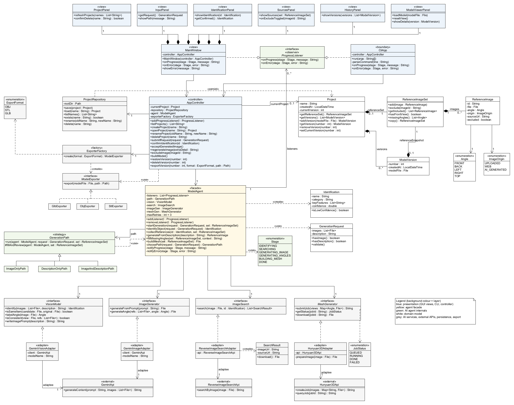
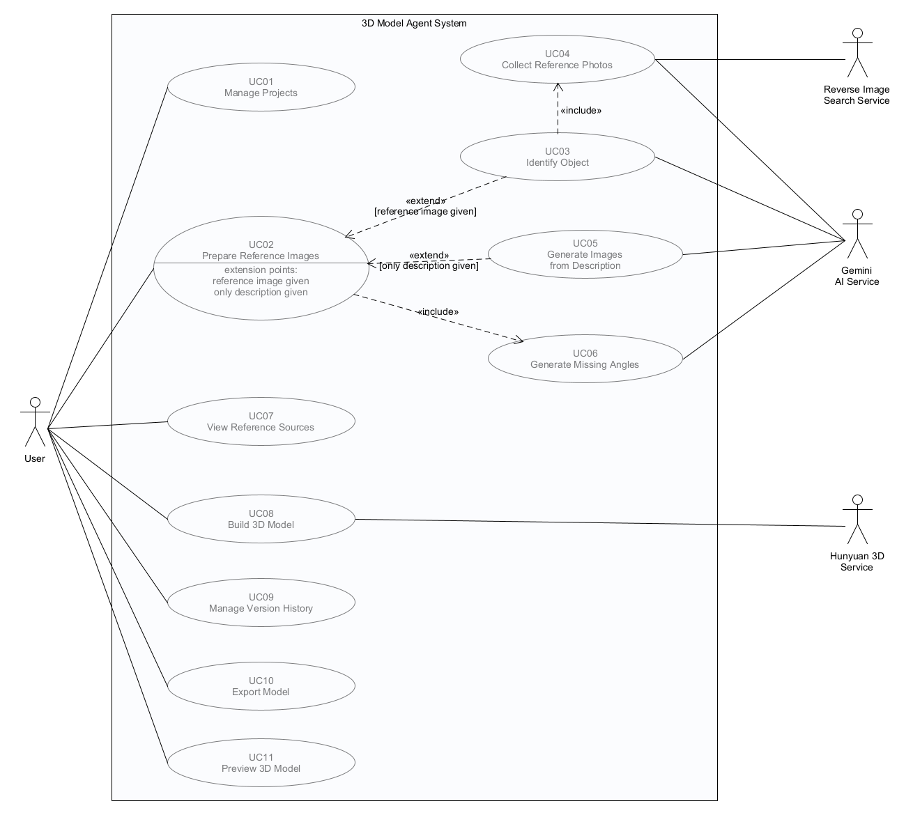
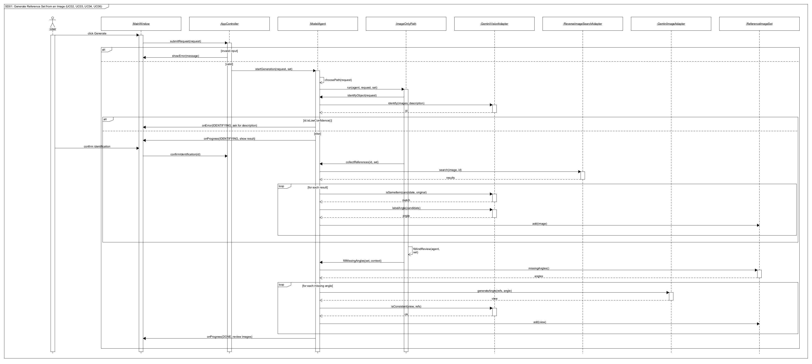
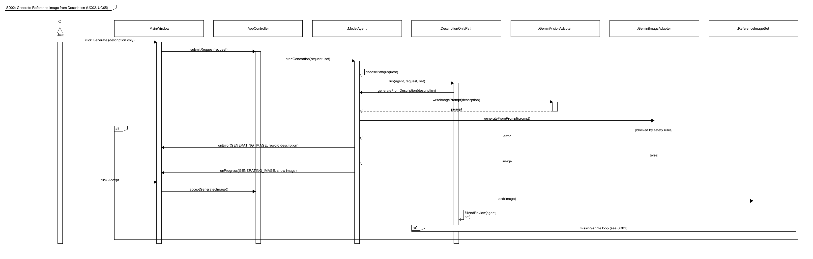
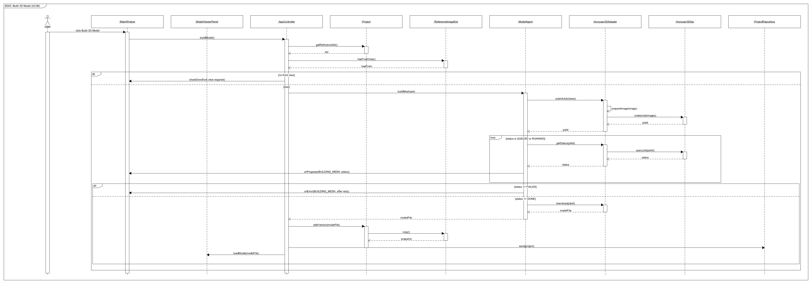
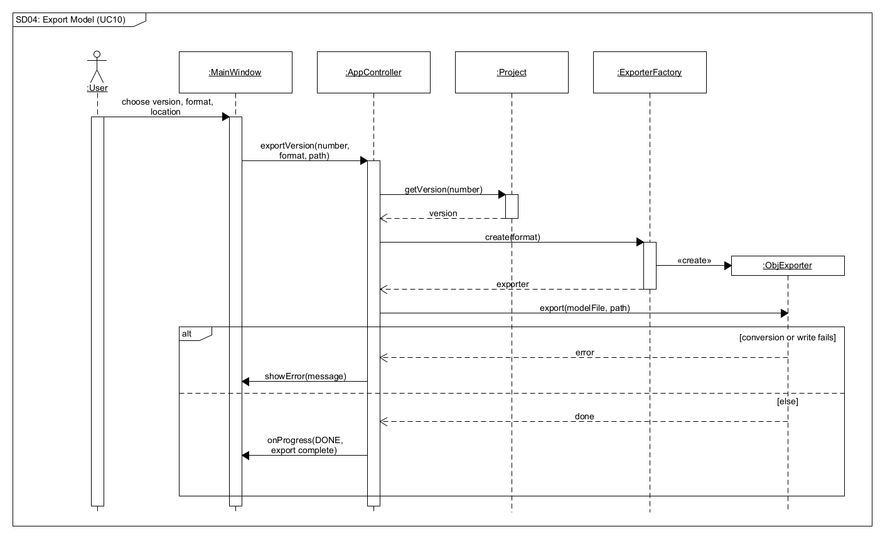
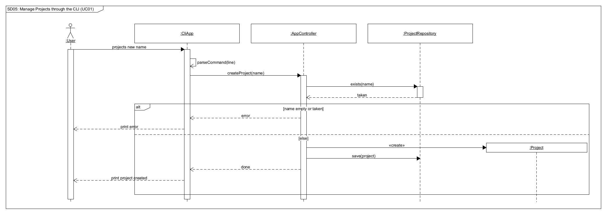
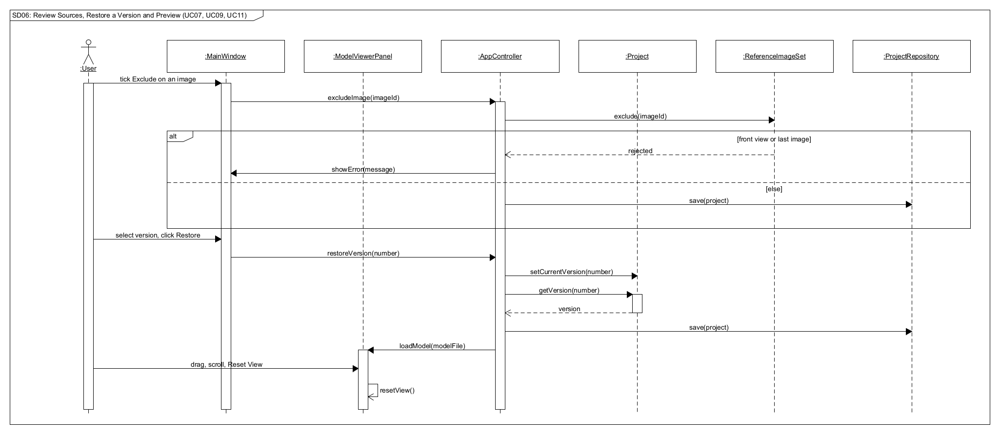

# EECS3311 Project Stage 1 Report
# AI 3D MESH GENERATOR
**Hans Kanu**


## 1. Project Overview

### 1.1 Problem and Motivation
3D Modeling is a skill and practice that is difficult and time consuming. It can be very discouraging for beginners who attempt to create a model in applications such as Blender, Maya, or even Marvelous Designer. Even those with creativity and skill cannot always fully translate their ideas into a finished model. So a tool as useful as AI is a valuable resource for both saving time and resources while also keeping quality. 

Current AI models for 3D generating rely heavily on user provided reference images. When recreating an object, they guess what the unseen sides of an object look like, often producing distorted or inaccurate results. Even when a model seems correct after multiple prompts, slight inaccuracies remain, and the user either has to spend time fixing them manually or fully regenerate the model and wait for a better one.

This application addresses these problems through the gathering of more information prior to generation. When provided reference images by the user, it reverse image searches in order to identify the item and find additional photos from other angles for better rendering. Any important angles not found online are generated by AI. Users may also leave descriptions of items for the AI to take into account when searching or generating an image. Using multiple views instead of a single image produces more accurate models with fewer distortions. Users aren't limited to just images; they may also provide a description as detailed as they like, or a description alone. This allows for a faster and more efficient workflow.

### 1.2 Target Users
Possible target users will be: 
- Professionals in the workplace (indie game developers, game artists, designers): This speeds up their workflow considerably and allows for much more progress to be made to meet deadlines and finish projects earlier. 
- Beginners first starting off and who have the ideas but not the skills: These are the people with the ideas for unique and possibly lucrative concepts but have no way to realize it because of the lack of skill. The app will let them bridge that gap without a 3rd party.
- Regular people/Hobbyists: People who may be curious to view the object or build for recreation like map concept artists, or someone with a 3d printer at home who can't find the oddly specific model online.

All of these users need 3D models created, each at a different level of professionalism.

### 1.3 Agent Description
The agent can:
- Reverse image search a reference image, along with a description of what it is if the user knows what it is (if not, that's fine).
- Get more photos of the item from the reverse image search.
- Generate different angles of the item to be used for generating a 3D mesh.
- Generate images based on the description in cases where there is no reference image and only a description.
- Check the image set with the user before mesh generation.
- Export the generated mesh as OBJ, STL, or GLB.


### 1.4 Why an AI Agent?
An agent is necessary for this task. The task it fulfills is not a simple question-response interaction, but requires the AI to reason in order to identify the object. It uses tools such as reverse image search, makes plans and procedures revolved around user input, and gathers & stores information before generating the 3D model. This is a complex multi-stage process which plain if-statements cannot figure out completely. All parts of the process rely on previous steps in order to be successful, which a simple LLM API call can't do.

### 1.5 AI/LLM Model(s)
| Model | Provider | Purpose in the system |
|---|---|---|
| Gemini vision model | Google | Agent "brain": identifies the object, plans the generation steps, interprets user descriptions |
| Gemini image generation model | Google | Generates missing angles, creates reference images from descriptions |
| Hunyuan 3D | Tencent | Generates the 3D mesh from the multi-view reference images |


### 1.6 Overall Architecture

The system follows a Model View Controller (MVC) architecture, with the agent logic kept in its own layer and the external AI services accessed only through abstractions. This keeps each part of the system responsible for a single task and allows services to be replaced without changing the rest of the code.

```
               View: GUI (MainWindow)      View: CLI (CliApp)
                          \                   /
                     Controller (AppController) ----> Model
                                 |              (Project, ReferenceImageSet,
                                 |               ReferenceImage, ModelVersion)
                    Agent Facade (ModelAgent)
           /              |                |               \
    «interface»      «interface»      «interface»      «interface»
    VisionModel      ImageSearch      ImageGenerator   MeshGenerator
         |                |                |                |
    GeminiVision     ReverseImage     GeminiImage      Hunyuan3D
    Adapter          SearchAdapter    Adapter          Adapter
         |                |                |                |
    Gemini API       Reverse Image    Gemini API       Hunyuan 3D API
    (agent brain)    Search API       (image gen)
```

- View (GUI + CLI): Displays information and collects user input, such as reference images and descriptions. Both views send requests to the same controller, so the core logic is only implemented once.
- Controller: Receives requests from either view, passes them to the agent, and updates the model with the results.
- Model: Holds the application's data: projects, the stored reference image sets, and each version of the generated 3D model. The image sets are stored so the user can view them and see where each image came from.
- Agent (Facade): The brain of the system. Its reasoning (identifying the object and planning the steps) is done by a Gemini vision model, which it reaches through the `VisionModel` interface like any other service. It provides one simple interface to the controller while hiding the multi-step process behind it: identifying the object, deciding which steps are needed based on the user's input (image, description, or both), and calling the appropriate services in order.
- External services (Adapters): Each external API has its own interface, so each one is wrapped in an adapter that implements a common interface defined by the system. The agent depends only on these interfaces, not on the specific providers. If a provider changes or is replaced, only its adapter needs to change.

**CLI coverage.** The CLI (`CliApp`) calls the same `AppController` methods as the GUI, so all major functionality is available from the command line:

| Command | Controller method | Feature |
|---|---|---|
| `projects list / new / open / rename / delete` | `listProjects`, `createProject`, `openProject`, `renameProject`, `deleteProject` | F01 |
| `generate --image <file> --desc "<text>"` | `submitRequest` | F02–F04, F06, F07 |
| `confirm`, `accept`, `regenerate "<detail>"`, `exclude <imageId>` | `confirmIdentification`, `acceptGeneratedImage`, `regenerateImage`, `excludeImage` | F03, F07 |
| `build` | `buildModel` | F08 |
| `versions restore / delete <n>` | `restoreVersion`, `deleteVersion` | F09 |
| `export <n> --format obj\|stl\|glb --out <path>` | `exportVersion` | F10 |

Progress is printed to the terminal as `CliApp` receives `onProgress` / `onError` updates. The 3D preview (F11) and the image source viewer (F05) are only in the GUI, because they are visual.


## 2. Detailed Feature Specifications

### Feature Summary
| ID | Feature Name | Type (Deterministic / AI / Hybrid) |
|---|---|---|
| F01 | Project library (create, open, rename, delete projects)| Deterministic|
| F02 | Flexible input (image, description, or both)| Hybrid|
| F03 | Object identification from reference image| AI|
| F04 | Reverse image search + reference photo collection| Hybrid|
| F05 | Reference source viewer| Deterministic|
| F06 | Reference image generation from description only| AI|
| F07 | Missing-angle generation| AI|
| F08 | Multi-view 3D mesh generation (Hunyuan)| Hybrid|
| F09 | Version history| Deterministic|
| F10 | Model export (OBJ / STL / GLB)| Deterministic|
| F11 | 3D model preview viewer (rotate/zoom)| Deterministic|

---

### F01 — Project Library

| Field | Details |
|---|---|
| **Description** | Lets the user organize their work into projects. Each project holds the user's inputs, the reference image set, and every generated version of the 3D model. |
| **User Interaction** | A Projects panel with New, Open, Rename, and Delete buttons. |
| **Input** | A project name (for create/rename) or a selected project (for open/delete). |
| **Output** | An updated project list, or the opened project's workspace. |
| **AI Involvement** | Deterministic. This is standard data management and needs no reasoning. |

**Expected Workflow:**
1. The user chooses an action in the Projects panel.
2. The view sends the request to the controller.
3. The controller validates the input (for example, that the name is not empty or already taken).
4. The project is created, renamed, opened, or removed in the model, and changes are saved to storage.
5. The view refreshes the project list or opens the project workspace.

**Error / Alternative Cases:**
- Duplicate project name → Show an error and ask for a different name.
- Empty name or invalid characters → Show a validation message and do not create the project.
- Delete selected → Ask the user to confirm, since deleting removes all images and model versions in the project.
- Project files missing or corrupted → Show an error and mark the project as unavailable instead of crashing.

---

### F02 — Flexible Input (Image, Description, or Both)

| Field | Details |
|---|---|
| **Description** | Accepts a reference image, a written description, or both, and starts a generation request. The agent decides which path the pipeline takes based on what was provided. |
| **User Interaction** | An input panel with an image upload area (browse or drag-and-drop), a description text box, and a Generate button. |
| **Input** | Zero or more reference images (JPG/PNG) and an optional text description. At least one of the two is required. |
| **Output** | A started generation request and a message showing the chosen path (for example, "Image + description received: identifying object"). |
| **AI Involvement** | Hybrid. Input validation is deterministic. The agent decides how to proceed: with an image, it moves to identification (F03); with only a description, it moves to reference image generation (F06). When both are given, the description is used to guide identification and searching. |

**Expected Workflow:**
1. The user uploads an image, types a description, or does both, then clicks Generate.
2. The view sends the inputs to the controller.
3. The controller validates file types, file sizes, and that at least one input exists.
4. The agent examines the inputs and chooses the path: image provided → F03; description only → F06.
5. The view shows the chosen path and the progress of the request.

**Error / Alternative Cases:**
- No image and no description → Show a message asking for at least one input.
- Unsupported file format or file too large → Reject the file and list the supported formats and size limit.
- Corrupted or unreadable image → Show an error and ask the user to upload a different image.
- Description too vague (e.g. "something cool") → The agent asks the user to add more detail before continuing.

---

### F03 — Object Identification from Reference Image

| Field | Details |
|---|---|
| **Description** | The agent uses the Gemini vision model to analyze the reference image (and the description, if given) to determine what the object is. The result guides the online search and later image generation. |
| **User Interaction** | Runs automatically after Generate. The result appears in an "Identified as" panel, where the user can confirm or correct it. |
| **Input** | The reference image(s) and the optional description. |
| **Output** | An identification result: object name, category, key visual features, and a confidence level. |
| **AI Involvement** | AI. Recognizing an object from a photo requires visual reasoning that rule-based code cannot do. |

**Expected Workflow:**
1. The agent sends the image and description to Gemini through its adapter.
2. Gemini returns a structured result (name, category, key features, confidence).
3. The view displays the result to the user.
4. The user confirms it or edits it.
5. The confirmed identification is passed to the reverse image search (F04).

**Error / Alternative Cases:**
- Object cannot be identified or confidence is low → Inform the user and ask for a description. If none is given, skip the online search and generate missing angles directly from the original image (F07).
- Description conflicts with the image → The agent flags the conflict and asks the user which one to trust.
- Gemini service unavailable → Show an error, keep the user's inputs, and offer a retry.

---

### F04 — Reverse Image Search and Reference Photo Collection

| Field | Details |
|---|---|
| **Description** | Searches online using the reference image and the identification result to find additional photos of the same item from other angles. The search can use the identified name as keywords (e.g. "Nike Air Jordan 1 Chicago side view"), the image itself (a visual reverse image search), or both, depending on the search service behind the adapter. The agent checks each found photo and keeps only the ones that show the same item. |
| **User Interaction** | Runs automatically after identification. A progress indicator is shown, followed by a gallery of the collected photos. |
| **Input** | The reference image and the identification result from F03. |
| **Output** | A reference image set containing the original image plus matching photos, each labeled with its angle (front, side, back, etc.) and its source URL. |
| **AI Involvement** | Hybrid. Calling the image search service is deterministic tool use. Deciding which results show the same item (not a different colour, a knockoff, or a similar product) and labeling each photo's angle is done by the agent. |

**Expected Workflow:**
1. The agent calls the image search service through its adapter.
2. The service returns candidate photos with their source URLs.
3. The candidate photos are downloaded.
4. The agent uses Gemini to compare each candidate to the original image and discards the ones that do not match.
5. The agent labels the angle of each kept photo.
6. The reference image set is saved in the model and displayed to the user.

**Error / Alternative Cases:**
- No search results → Inform the user and fall back to generating the missing angles from the original image (F07).
- All candidates rejected as non-matching → Same fallback as above.
- Search service unavailable or request limit reached → Notify the user and continue with the fallback.
- A single photo fails to download → Skip that photo and continue with the rest.

---

### F05 — Reference Source Viewer

| Field | Details |
|---|---|
| **Description** | Shows every photo in the project's reference set along with its origin: uploaded by the user, found online (with a link to the source), or generated by AI. The user can exclude photos they do not want used for the 3D model. |
| **User Interaction** | A Sources tab with thumbnails, an origin label, a clickable source link, and an Exclude checkbox for each photo. |
| **Input** | The current project's reference image set, and any exclusions chosen by the user. |
| **Output** | A list of all reference photos with their origins, and an updated reference set. |
| **AI Involvement** | Deterministic. It displays stored information and updates the set based on the user's choices. |

**Expected Workflow:**
1. The user opens the Sources tab.
2. The controller retrieves the reference set from the model.
3. The view displays each photo with its origin label and source link.
4. If the user excludes a photo, the controller updates the reference set in the model.
5. Excluding photos allows the user to regenerate the model with a different set, which creates a new version (F09).

**Error / Alternative Cases:**
- Source link no longer works → Show "source unavailable" while keeping the stored copy of the photo.
- User tries to exclude the front view → Warn the user, since the 3D generation service requires a front view.
- User tries to exclude every photo → Block the action and explain that at least one photo is required.

---

### F06 — Reference Image Generation from Description Only

| Field | Details |
|---|---|
| **Description** | When the user provides only a description, the agent creates the first reference image using the Gemini image generation model. |
| **User Interaction** | Triggered by F02 when only a description is given. The generated image is shown with Accept and Regenerate buttons. |
| **Input** | The user's text description. |
| **Output** | A generated front-view reference image, added to the reference set and labeled as AI-generated. |
| **AI Involvement** | AI. The agent turns the description into a detailed image prompt, and the image model creates the image. |

**Expected Workflow:**
1. The agent uses Gemini to turn the user's description into a detailed image prompt.
2. The agent calls the image generation service through its adapter.
3. The generated image is shown to the user.
4. The user accepts it or asks for a regeneration (optionally adding more detail).
5. The accepted image is saved to the reference set, and the pipeline continues to F07.

**Error / Alternative Cases:**
- Request blocked by the service's content safety rules → Explain that the image could not be generated and ask the user to rephrase the description.
- Generated image does not match what the user wanted → The user regenerates, optionally adding more detail.
- Image generation service unavailable → Show an error and offer a retry.

---

### F07 — Missing-Angle Generation

| Field | Details |
|---|---|
| **Description** | The agent checks which important angles (front, back, left, right, top) are missing from the reference set and generates only those, keeping them consistent with the existing images. |
| **User Interaction** | Runs automatically. The completed set is shown, with generated angles marked as AI-generated. |
| **Input** | The current reference set with angle labels, and the identification result or description. |
| **Output** | A complete multi-view reference set. |
| **AI Involvement** | AI. The agent plans which angles are needed, generates them, and checks that they are consistent with the real images. |

**Expected Workflow:**
1. The agent compares the angles in the reference set against the list of required angles.
2. For each missing angle, the agent calls the image generation service, using the existing images as references.
3. The agent uses Gemini to check that each generated view is consistent with the existing images.
4. If a view is inconsistent, the agent regenerates it, up to a set number of attempts.
5. The completed set is saved in the model.

**Error / Alternative Cases:**
- All required angles are already present → Skip this step and continue to F08.
- A generated view is still inconsistent after the maximum number of attempts → Warn the user and let them continue anyway or exclude that view (F05).
- Image generation service fails partway → Keep the views generated so far and offer a retry for the rest.

---

### F08 — Multi-View 3D Mesh Generation

| Field | Details |
|---|---|
| **Description** | Sends the completed reference set to Tencent Hunyuan 3D, retrieves the generated 3D model, and saves it as a new version in the project. |
| **User Interaction** | Starts automatically once the reference set is complete, or through a "Build 3D Model" button. A progress indicator is shown, and the user can keep using the app while waiting. |
| **Input** | The final reference set (a front view is required; other views are optional). |
| **Output** | A 3D model file saved as a new version, then displayed in the preview viewer (F11). |
| **AI Involvement** | Hybrid. The mesh is created by an external AI model. Preparing the images, submitting the job, checking its status, and saving the result are deterministic. |

**Expected Workflow:**
1. The controller asks the agent to build the model.
2. The agent matches each image to the view label expected by the service (front, back, left, right, etc.).
3. The mesh generation adapter resizes or converts any images that do not meet the service's format and size requirements.
4. The job is submitted to Hunyuan 3D.
5. The adapter checks the job status until it finishes (this can take several minutes).
6. The finished model is downloaded and saved as a new version (F09).
7. The view displays the model in the preview viewer (F11).

**Error / Alternative Cases:**
- No front view in the set → Block the build and explain that a front view is required.
- Job fails or times out → Notify the user, keep the reference set, and offer a retry.
- Service unavailable or insufficient credits → Show an error explaining the problem.

---

### F09 — Version History

| Field | Details |
|---|---|
| **Description** | Every completed 3D generation is saved as a version, along with the reference set used to create it and a timestamp. The user can browse, open, restore, or delete versions. New versions are created when the user regenerates, for example after excluding photos in F05 or regenerating images. |
| **User Interaction** | A History panel listing all versions. |
| **Input** | A selected version. |
| **Output** | The list of versions, or the selected version's model and reference set. A restored version becomes the current one. |
| **AI Involvement** | Deterministic. Versions are stored and retrieved without any reasoning. |

**Expected Workflow:**
1. When F08 finishes, the controller saves the model and its reference set as a new version.
2. The user opens the History panel.
3. The user selects a version.
4. The controller loads it from the model.
5. The view displays its reference images and 3D model. If restored, it becomes the current version.

**Error / Alternative Cases:**
- Version files missing or corrupted → Mark the version as unavailable instead of crashing.
- User deletes the current version → Ask for confirmation, then switch to the most recent remaining version.
- No versions yet → Show a message that no models have been generated in this project.

---

### F10 — Model Export (OBJ / STL / GLB)

| Field | Details |
|---|---|
| **Description** | Exports a selected model version to a file in OBJ, STL, or GLB format so it can be used in other software or for 3D printing. |
| **User Interaction** | An Export button with a format dropdown and a save dialog. |
| **Input** | The version to export, the file format, and the save location. |
| **Output** | The exported model file at the chosen location. |
| **AI Involvement** | Deterministic. Format conversion and file writing follow fixed rules. |

**Expected Workflow:**
1. The user selects a version, a format, and a save location.
2. The controller loads the model from the version history.
3. The model is converted to the chosen format (the service returns GLB, so OBJ and STL require conversion).
4. The file is written to the chosen location.
5. The view confirms that the export succeeded.

**Error / Alternative Cases:**
- Conversion fails → Show an error and suggest a different format.
- Save location not writable → Show an error and ask for a different location.
- File already exists → Ask the user whether to overwrite it.
- STL selected → Warn the user that STL does not store colours or textures.

---

### F11 — 3D Model Preview Viewer

| Field | Details |
|---|---|
| **Description** | Displays the current 3D model in an interactive view so the user can inspect it before exporting. |
| **User Interaction** | A viewer panel where the user drags to rotate, scrolls to zoom, and clicks Reset View to return to the default angle. |
| **Input** | A model version (the current one by default). |
| **Output** | An interactive 3D view of the model. |
| **AI Involvement** | Deterministic. Rendering and camera controls follow fixed rules. |

**Expected Workflow:**
1. When F08 finishes or the user opens a version in F09, the controller loads the model file.
2. The viewer renders the model.
3. The user rotates and zooms to inspect it.

**Error / Alternative Cases:**
- Model file cannot be loaded or is corrupted → Show an error and offer to regenerate the model.
- Model is very large and slow to display → Show a simplified preview and note that the full model is available through export.
- 3D rendering not supported on the user's computer → Show the reference images and model details instead.

---

## 3. UML Class Diagram



_Diagram source: [diagrams/class_diagram.uxf](diagrams/class_diagram.uxf) (UMLet)._

### 3.1 Layers

The diagram has no package frames. Each class's layer is shown by its background colour, as explained in the legend (bottom right of the diagram).

- **Presentation (blue):**
  - `MainWindow` is the GUI. It is made of one `«view»` panel per area of the app: `ProjectPanel` (F01), `InputPanel` (F02), `IdentificationPanel` (F03, F06), `SourcesPanel` (F04, F05, F07), `HistoryPanel` (F09) and `ModelViewerPanel` (F11).
  - `CliApp` (`«boundary»`) is the command-line view.
  - Both views only call `AppController`, and both implement `ProgressListener` so they receive progress updates during long jobs.
  - `AppController` (`«controller»`) receives every request from either view. It holds the open `Project`, saves changes through `ProjectRepository`, passes generation work to `ModelAgent`, gets a `ModelExporter` from `ExporterFactory` and calls it to export.
- **Agent facade (yellow):** `ModelAgent` gives the controller a small set of methods and hides the multi-step pipeline behind them.
  - It reads the user's `GenerationRequest` and creates the `Identification` of the object.
  - `choosePath()` picks a `GenerationPath` based on what the user provided (image only, description only, or both).
  - The agent then calls the services in order: identify, search, check matches, generate missing angles, check consistency (retrying up to `maxRetries`), and build the mesh.
  - It reports each `Stage` to the `ProgressListener`s registered through `addListener()`.
- **Agent internals (green):** `ProgressListener`, the `GenerationPath` strategies and the `Stage` enumeration.
  - `GenerationPath` is an abstract class. Each subclass overrides the abstract `run()` with its own steps. All three inherit the shared `fillAndReview()`, which generates any missing angles and hands the image set to the user for review, so that step is written only once.
- **Domain model (white):**
  - `Project` owns one `ReferenceImageSet` and any number of `ModelVersion`s. Each version owns its own snapshot of the reference set it was built from (F09). A reference set therefore belongs to either a project or a version, which is why the owner end of both compositions is `0..1`.
  - `ReferenceImage` records each photo's `Angle`, `ImageOrigin` (uploaded, web or AI-generated) and source link (F05).
  - `Identification` holds the result of F03, and `GenerationRequest` holds the user's input from F02.
- **AI services, external APIs, persistence and export (grey):**
  - The agent only depends on four interfaces: `VisionModel`, `ImageSearch`, `ImageGenerator` and `MeshGenerator`.
  - Each provider is wrapped in an `«adapter»` that implements one of them: `GeminiVisionAdapter`, `GeminiImageAdapter`, `ReverseImageSearchAdapter` and `Hunyuan3DAdapter`.
  - Each adapter holds the provider's own API client (its adaptee), marked `«external»`: `GeminiApi` (shared by both Gemini adapters), `ReverseImageSearchApi` and `Hunyuan3DApi`.
  - `ReverseImageSearchAdapter` creates the `SearchResult`s. `Hunyuan3DAdapter` resizes and converts images to meet the service's requirements, and reports job progress as a `JobStatus`.
  - `ProjectRepository` saves and loads projects (F01, F09). `ExporterFactory` returns the right `ModelExporter` (`GlbExporter`, `ObjExporter` or `StlExporter`) for the chosen `ExportFormat` (F10).

**Notation:**
- Solid arrow: association, with multiplicities and role names (e.g. `listeners`, `adaptee`).
- Filled diamond: composition, at the owner's end.
- Solid line with a hollow triangle: inheritance (a subclass extending a class).
- Dashed arrow with a hollow triangle: an interface being implemented.
- Italics: an abstract class, interface or abstract method.
- Dashed open arrow: a dependency, labelled `«use»`, `«create»` or `«persist»`.

### 3.2 Design Patterns in the Diagram

Each pattern's key classes carry a matching stereotype where one applies (`«facade»`, `«adapter»`, `«strategy»`, `«factory»`, `«observer»`). Each pattern is explained in Section 4. The overall MVC architecture is shown by the `«view»` and `«controller»` stereotypes and the blue/white layers.

| Pattern | Classes |
|---|---|
| Facade | `ModelAgent` |
| Adapter | Targets: `VisionModel`, `ImageSearch`, `ImageGenerator`, `MeshGenerator`; adapters: `GeminiVisionAdapter`, `ReverseImageSearchAdapter`, `GeminiImageAdapter`, `Hunyuan3DAdapter`; adaptees: `GeminiApi`, `ReverseImageSearchApi`, `Hunyuan3DApi` |
| Strategy | `GenerationPath` (abstract strategy), `ImageOnlyPath`, `DescriptionOnlyPath`, `ImageAndDescriptionPath` |
| Factory | `ExporterFactory`, `ModelExporter`, `GlbExporter`, `ObjExporter`, `StlExporter` |
| Observer | `ModelAgent` (subject: `listeners` association, `addListener`, `removeListener`, `notifyProgress`); `ProgressListener` (observer interface); `MainWindow`, `CliApp` (concrete observers) |
| Prototype | `ReferenceImageSet` (`copy()` makes the deep copy that becomes a `ModelVersion`'s `referenceSnapshot`) |

---

## 4. Design Pattern Explanations

The system uses six design patterns from the course: Facade, Adapter, Strategy, Observer, Factory and Prototype. MVC is the overall architecture of the application (Section 1.6) and is not counted as one of these patterns.

### 4.1 Facade
- **Pattern:** Facade (structural)
- **Participating classes:**
  - `ModelAgent` («facade»): the single entry point for the whole generation process, through `startGeneration()`, `identifyObject()`, `collectReferences()`, `fillMissingAngles()` and `buildMesh()`.
  - Subsystem: `VisionModel`, `ImageSearch`, `ImageGenerator`, `MeshGenerator` and the `GenerationPath` strategies.
  - Client: `AppController`, which only ever talks to the facade.
- **Problem addressed:** Making a model is not one step but many. The object has to be identified, a path chosen, a reverse image search run, the matches checked, missing angles generated and checked for consistency, and finally the mesh built. Four different services are involved along the way. If the controller had to manage all of this itself, it would need to know every service and the exact order to call them in.
- **Rationale for using it:** The facade gives the controller one simple interface and keeps the complicated process behind it. The agent's planning is the part of the system most likely to change during development, so keeping it inside `ModelAgent` means the controller and both views do not have to change with it. Without the facade, `AppController` would hold all four services and handle every retry and error on its own, turning it into a large class with too many responsibilities.

### 4.2 Adapter
- **Pattern:** Adapter (structural, object adapter)
- **Participating classes:**
  - Targets: `VisionModel`, `ImageSearch`, `ImageGenerator`, `MeshGenerator`. These are the interfaces the system defines and the agent expects.
  - Adapters: `GeminiVisionAdapter`, `GeminiImageAdapter`, `ReverseImageSearchAdapter`, `Hunyuan3DAdapter`. Each one implements a target and holds the provider it wraps.
  - Adaptees: `GeminiApi`, `ReverseImageSearchApi`, `Hunyuan3DApi` («external»). These are the providers' own clients, which do not match the system's interfaces.
  - Client: `ModelAgent`.
- **Problem addressed:** Every outside service works differently. Each has its own request format, login method and type of response, and some run as jobs that have to be checked on. For example, Hunyuan uses `createJob()` and `queryJob()`, while the system expects `submitJob()`, `getStatus()` and `download()`. The agent should not be tied to any one provider, since a provider could change its API, become too expensive or shut down.
- **Rationale for using it:** Each adapter translates between what the agent asks for and what the provider actually offers. Only the adapter knows about both sides, so the agent and the provider stay completely separate. If a provider is replaced, only one new adapter has to be written. It also allows fake adapters to be used for testing without paying for API calls. Without adapters, the code for building requests, reading responses and checking job status for every provider would end up inside `ModelAgent`, and changing a provider would mean rewriting parts of the agent.

### 4.3 Strategy
- **Pattern:** Strategy (behavioural)
- **Participating classes:**
  - Strategy: `GenerationPath` («strategy», abstract class). It declares `run()` and provides the `fillAndReview()` step that every path finishes with.
  - Concrete strategies: `ImageOnlyPath`, `DescriptionOnlyPath`, `ImageAndDescriptionPath`. Each one overrides `run()` with its own steps.
  - Context: `ModelAgent`, which picks the strategy in `choosePath()`, stores it in `path` and runs it from `startGeneration()`.
- **Problem addressed:** The agent has to follow a different process depending on what the user gives it (F02). With only an image, it identifies the object and runs a reverse image search. With only a description, it has to generate the reference images first (F06). With both, it uses the description to improve the identification and search. Writing all three as `if/else` blocks inside the agent would make `ModelAgent` long and hard to add to.
- **Rationale for using it:** All three paths do the same job, which is producing a reviewed set of reference images, just in different ways. The right one can only be chosen once the user's request comes in. Putting each path in its own class means one can be changed or tested without affecting the others. Without Strategy, `startGeneration()` would become one large conditional, and supporting a new input type, such as a sketch, would mean editing it and risking breaking the existing paths.

### 4.4 Observer
- **Pattern:** Observer (behavioural)
- **Participating classes:**
  - Subject: `ModelAgent`. It keeps a `listeners` list, adds and removes observers with `addListener()` / `removeListener()`, and notifies them through `notifyProgress()` / `notifyError()`.
  - Observer: `ProgressListener` («observer», interface), with `onProgress(stage, message)` and `onError(stage, error)`.
  - Concrete observers: `MainWindow`, which updates its progress display, and `CliApp`, which prints a line to the terminal. Both register through `AppController.addProgressListener()`.
- **Problem addressed:** Generating a model takes time. Searching, generating images and building the mesh can each take minutes, and the user needs to see what stage the process is at and whether anything has gone wrong. At the same time, the agent should not need to know whether it is reporting to the GUI, the CLI or both.
- **Rationale for using it:** The agent sends out its updates, and whoever has registered receives them, without the agent knowing who they are. This keeps the agent separate from the interface, which is what MVC requires. Without Observer, `ModelAgent` would need direct references to `MainWindow` and `CliApp`, tying the agent to the UI, or the views would have to keep asking the agent for its status, which wastes work and delays updates.

### 4.5 Factory
- **Pattern:** Factory (creational, where a parameter tells the factory which class to return)
- **Participating classes:**
  - Factory: `ExporterFactory` («factory»). Its `create(format : ExportFormat)` returns the matching exporter.
  - Base type: `ModelExporter` («interface»), with `export(modelFile, path)`.
  - Products: `GlbExporter`, `ObjExporter`, `StlExporter`.
  - Client: `AppController`, which uses the exporter it is given without knowing which class it is.
- **Problem addressed:** The user chooses OBJ, STL or GLB when exporting (F10), and each format needs its own exporter. If the controller created exporters directly with `new`, it would depend on every exporter class and need a switch on the format everywhere exporting happens.
- **Rationale for using it:** The format is only known when the user chooses it, so the factory makes that decision in one place. Since every exporter has the same `export()` method, the controller does not care which one it gets. Without the factory, the same creation code would be repeated in both the GUI and CLI flows, and adding a new format such as FBX would mean finding and editing each of those places instead of adding one class and one case to the factory.

### 4.6 Prototype
- **Pattern:** Prototype (creational)
- **Participating classes:**
  - Prototype: `ReferenceImageSet`. Its `copy()` returns a deep copy of the set, including every `ReferenceImage` and whether it has been excluded.
  - Client: `AppController` / `Project`, which ask the current set to copy itself when `buildModel()` saves a new `ModelVersion`.
  - Result: the copy is stored as that version's `referenceSnapshot`.
- **Problem addressed:** Each version of a model has to remember exactly which images it was built from (F09), even if the user changes the project's images later. Building that set again from scratch would mean repeating the slow and costly search and generation steps.
- **Rationale for using it:** It is much cheaper to copy the set that already exists than to build a new one. The copy has to be a deep copy so that later changes to the working set do not show up in older versions. Without Prototype, either every version would share the same set, so editing it would quietly change past versions, or the controller would have to rebuild each set piece by piece, which is easy to get wrong.

---

## 5. Use-Case Diagram



_Diagram source: [diagrams/use_case_diagram.uxf](diagrams/use_case_diagram.uxf) (UMLet)._

### 5.1 Actors
| Actor | Type | Role |
|---|---|---|
| User | Primary (human) | Uses the app through the GUI or CLI to create projects, give reference images and descriptions, review images, and build, preview and export models. |
| Gemini AI Service | Secondary (external system) | Identifies the object, checks whether search results match, generates images from descriptions and generates missing angles. |
| Reverse Image Search Service | Secondary (external system) | Finds other photos of the identified object online. |
| Hunyuan 3D Service | Secondary (external system) | Builds the 3D mesh from the finished set of reference images. |

### 5.2 Major Use Cases
| Use Case | Name | Primary Actor | Secondary Actor(s) | Relationship |
|---|---|---|---|---|
| UC01 | Manage Projects | User | | |
| UC02 | Prepare Reference Images | User | | `«include»` UC06; extended by UC03 and UC05 |
| UC03 | Identify Object | | Gemini AI Service | `«extend»` UC02 [reference image given]; `«include»` UC04 |
| UC04 | Collect Reference Photos | | Reverse Image Search Service, Gemini AI Service | included by UC03 |
| UC05 | Generate Images from Description | | Gemini AI Service | `«extend»` UC02 [only description given] |
| UC06 | Generate Missing Angles | | Gemini AI Service | included by UC02 |
| UC07 | View Reference Sources | User | | |
| UC08 | Build 3D Model | User | Hunyuan 3D Service | |
| UC09 | Manage Version History | User | | |
| UC10 | Export Model | User | | |
| UC11 | Preview 3D Model | User | | |

### 5.3 Coverage of All Major Features
Every feature from Section 2 is covered by exactly one use case.

| Feature | Feature Name | Use Case |
|---|---|---|
| F01 | Project library | UC01 Manage Projects |
| F02 | Flexible input (image, description, or both) | UC02 Prepare Reference Images |
| F03 | Object identification from reference image | UC03 Identify Object |
| F04 | Reverse image search + reference photo collection | UC04 Collect Reference Photos |
| F05 | Reference source viewer | UC07 View Reference Sources |
| F06 | Reference image generation from description only | UC05 Generate Images from Description |
| F07 | Missing-angle generation | UC06 Generate Missing Angles |
| F08 | Multi-view 3D mesh generation | UC08 Build 3D Model |
| F09 | Version history | UC09 Manage Version History |
| F10 | Model export | UC10 Export Model |
| F11 | 3D model preview viewer | UC11 Preview 3D Model |

---

## 6. Detailed Use-Case Descriptions

### UC01 — Manage Projects
| Field | Details |
|---|---|
| **Actor(s)** | User |
| **Goal** | Create, open, rename or delete a project. |
| **Preconditions** | The app is running. |
| **Trigger** | The user picks an action in the Projects panel or CLI. |
| **Main Success Scenario** | 1. The user picks an action and a project name. <br> 2. The controller validates the name. <br> 3. The project is updated and saved, and the list refreshes. |
| **Alternative / Exception Flows** | 2a. Name empty or taken: the user is asked for another name. <br> 3a. Delete chosen: the user must confirm first. |
| **Postconditions** | The project list is saved, or the chosen project is open. |
| **Related Feature(s)** | F01 |

### UC02 — Prepare Reference Images
| Field | Details |
|---|---|
| **Actor(s)** | User |
| **Goal** | Turn the user's image and/or description into a complete set of reference images. |
| **Preconditions** | A project is open. |
| **Trigger** | The user clicks Generate or runs `generate`. |
| **Main Success Scenario** | 1. The user gives an image, a description, or both. <br> 2. The controller validates the input. <br> 3. The agent picks a path. **Extension points:** reference image given (UC03), only description given (UC05). <br> 4. Missing angles are filled in (UC06). <br> 5. The user reviews and accepts the set, and it is saved. |
| **Alternative / Exception Flows** | 2a. No input or an invalid file: the user is asked to fix it. <br> 3a. Description too vague: the agent asks for more detail. |
| **Postconditions** | The project has a complete reference set. |
| **Related Feature(s)** | F02 |

### UC03 — Identify Object
| Field | Details |
|---|---|
| **Actor(s)** | Gemini AI Service (the User confirms the result through UC02) |
| **Goal** | Work out what object is in the reference image. |
| **Preconditions** | The user gave a reference image. |
| **Trigger** | UC02 reaches "reference image given". |
| **Main Success Scenario** | 1. The agent sends the image to Gemini. <br> 2. Gemini returns the object's name, features and confidence. <br> 3. The user confirms the result. <br> 4. More photos are collected (UC04). |
| **Alternative / Exception Flows** | 2a. Low confidence: the user is asked for a description. If none is given, the search is skipped. <br> 2b. Gemini unavailable: an error is shown and a retry is offered. |
| **Postconditions** | A confirmed identification is stored. |
| **Related Feature(s)** | F03 |

### UC04 — Collect Reference Photos
| Field | Details |
|---|---|
| **Actor(s)** | Reverse Image Search Service, Gemini AI Service |
| **Goal** | Find more photos of the same object from other angles. |
| **Preconditions** | The object has been identified (UC03). |
| **Trigger** | Included by UC03. |
| **Main Success Scenario** | 1. The agent runs a reverse image search. <br> 2. Gemini checks each result and keeps only matching photos. <br> 3. Kept photos are labeled by angle and added to the set. |
| **Alternative / Exception Flows** | 1a. No results or the service is down: the system continues with only the original image. |
| **Postconditions** | The set contains the matching photos with their sources. |
| **Related Feature(s)** | F04 |

### UC05 — Generate Images from Description
| Field | Details |
|---|---|
| **Actor(s)** | Gemini AI Service (the User accepts the image through UC02) |
| **Goal** | Create a first reference image from a description. |
| **Preconditions** | The user gave only a description. |
| **Trigger** | UC02 reaches "only description given". |
| **Main Success Scenario** | 1. Gemini turns the description into an image prompt. <br> 2. Gemini generates a front-view image. <br> 3. The user accepts it and it is added to the set. |
| **Alternative / Exception Flows** | 2a. Blocked by safety rules: the user is asked to reword the description. <br> 3a. The user rejects the image: it is regenerated. |
| **Postconditions** | The set has an AI-generated front view. |
| **Related Feature(s)** | F06 |

### UC06 — Generate Missing Angles
| Field | Details |
|---|---|
| **Actor(s)** | Gemini AI Service |
| **Goal** | Fill in the angles the set is missing. |
| **Preconditions** | The set has at least one image. |
| **Trigger** | Included by UC02. |
| **Main Success Scenario** | 1. The agent finds the missing angles. <br> 2. Gemini generates each missing view. <br> 3. Each view is checked for consistency and added to the set. |
| **Alternative / Exception Flows** | 1a. Nothing is missing: this step is skipped. <br> 3a. A view is still inconsistent after the retry limit: the user is warned. |
| **Postconditions** | The set covers all required angles. |
| **Related Feature(s)** | F07 |

### UC07 — View Reference Sources
| Field | Details |
|---|---|
| **Actor(s)** | User |
| **Goal** | See where each image came from and exclude unwanted ones. |
| **Preconditions** | The project has a reference set. |
| **Trigger** | The user opens the Sources tab. |
| **Main Success Scenario** | 1. Each image is shown with its origin and source link. <br> 2. The user excludes any unwanted images. <br> 3. The set is updated and saved. |
| **Alternative / Exception Flows** | 2a. The user excludes the front view or every image: the action is blocked or warned against. |
| **Postconditions** | The set reflects the user's exclusions. |
| **Related Feature(s)** | F05 |

### UC08 — Build 3D Model
| Field | Details |
|---|---|
| **Actor(s)** | User, Hunyuan 3D Service |
| **Goal** | Generate a 3D model from the reference set. |
| **Preconditions** | The set includes a front view. |
| **Trigger** | The set is accepted, or the user clicks Build or runs `build`. |
| **Main Success Scenario** | 1. The images are prepared and sent to Hunyuan 3D. <br> 2. The job is checked until it finishes. <br> 3. The model is downloaded and saved as a new version. <br> 4. The model can then be previewed (UC11). |
| **Alternative / Exception Flows** | 1a. No front view: the build is blocked. <br> 2a. The job fails or times out: the user is told and a retry is offered. |
| **Postconditions** | A new version is saved and becomes current. |
| **Related Feature(s)** | F08 |

### UC09 — Manage Version History
| Field | Details |
|---|---|
| **Actor(s)** | User |
| **Goal** | Browse, restore or delete earlier versions. |
| **Preconditions** | A project is open. |
| **Trigger** | The user opens the History panel or runs `versions`. |
| **Main Success Scenario** | 1. The versions are listed. <br> 2. The user selects one and views it. <br> 3. The user restores it, and it becomes current. |
| **Alternative / Exception Flows** | 1a. No versions yet: a message is shown. <br> 3a. The user deletes it instead: confirmation is required. |
| **Postconditions** | The selected version is current, or it has been deleted. |
| **Related Feature(s)** | F09 |

### UC10 — Export Model
| Field | Details |
|---|---|
| **Actor(s)** | User |
| **Goal** | Save a model as an OBJ, STL or GLB file. |
| **Preconditions** | The project has at least one version. |
| **Trigger** | The user clicks Export or runs `export`. |
| **Main Success Scenario** | 1. The user picks a version, format and location. <br> 2. The right exporter converts and writes the file. <br> 3. The export is confirmed. |
| **Alternative / Exception Flows** | 2a. Conversion fails or the location isn't writable: an error is shown. <br> 2b. The file already exists: the user is asked whether to overwrite it. |
| **Postconditions** | The file is saved in the chosen format. |
| **Related Feature(s)** | F10 |

### UC11 — Preview 3D Model
| Field | Details |
|---|---|
| **Actor(s)** | User |
| **Goal** | Inspect the model from every side before exporting. |
| **Preconditions** | The project has at least one version. |
| **Trigger** | A build finishes, or the user opens a version. |
| **Main Success Scenario** | 1. The model is loaded into the viewer. <br> 2. The user rotates and zooms to inspect it. |
| **Alternative / Exception Flows** | 1a. The file is corrupted or can't be displayed: an error is shown and the reference images are shown instead. |
| **Postconditions** | No data changes. |
| **Related Feature(s)** | F11 |

---

## 7. Sequence Diagrams

The six diagrams below cover every use case from Section 5. Every message is a method from the class diagram in Section 3. Each diagram shows the user, the view (`MainWindow` or `CliApp`), `AppController`, `ModelAgent`, the adapters for the external services, and the model classes. Error flows are shown with `alt` fragments and repeated steps with `loop` fragments. Diagram sources are the matching `.uxf` files in `diagrams/` (UMLet).

### SD01 — Generate Reference Set from an Image (UC02, UC03, UC04, UC06)


The controller passes the request to `ModelAgent`, which picks `ImageOnlyPath`. The path identifies the object through Gemini, the user confirms it, then the path runs the reverse image search, and keeps only matching photos. It then fills in the missing angles with a consistency check. **Alt flows:** invalid input shows an error; a low-confidence identification asks the user for a description and skips the search.

### SD02 — Generate Reference Image from Description (UC02, UC05)


`DescriptionOnlyPath` has Gemini write an image prompt from the description, then generates a front view. The user accepts it, and the path continues with the same missing-angle step as SD01. **Alt flow:** if the request is blocked by safety rules, the user is asked to reword the description.

### SD03 — Build 3D Model (UC08)


The controller checks for a front view, then `ModelAgent` submits the job through `Hunyuan3DAdapter`, which prepares the images and calls the Hunyuan API. A loop checks the job status and reports progress to the view. When the job is done, the model is saved as a new version with a copy of the reference set, and shown in the viewer. **Alt flows:** no front view blocks the build; a failed job offers a retry.

### SD04 — Export Model (UC10)


The controller gets the version, asks `ExporterFactory` for the exporter that matches the chosen format, and calls `export()`. **Alt flow:** if the conversion or the file write fails, an error is shown.

### SD05 — Manage Projects through the CLI (UC01)


This shows the CLI using the same controller as the GUI. `CliApp` parses the command and calls `createProject()`, which checks the name in `ProjectRepository`, creates the project and saves it. **Alt flow:** an empty or taken name returns an error.

### SD06 — Review Sources, Restore a Version and Preview (UC07, UC09, UC11)


The user excludes an image, restores an earlier version, and inspects it in the viewer. Each change is saved through `ProjectRepository`. **Alt flow:** excluding the front view or the last image is rejected.

---

## 8. Feature-to-Design Traceability Table

| Feature | Description | Type | Related Use Case | Classes | Key Methods | Sequence Diagram | Design Pattern(s) |
|---|---|---|---|---|---|---|---|
| F01 | Create, open, rename and delete projects that hold the user's work | Deterministic | UC01 | `CliApp`, `MainWindow`, `AppController`, `ProjectRepository`, `Project` | `createProject()`, `openProject()`, `renameProject()`, `deleteProject()`, `exists()`, `save()` | SD05 | None (MVC architecture) |
| F02 | Accept an image, a description or both, and choose the matching generation path | Hybrid | UC02 | `MainWindow`, `AppController`, `GenerationRequest`, `ModelAgent`, `GenerationPath` subclasses | `submitRequest()`, `validate()`, `startGeneration()`, `choosePath()`, `run()` | SD01, SD02 | Facade, Strategy |
| F03 | Identify the object in the reference image and let the user confirm it | AI | UC03 | `ModelAgent`, `ImageOnlyPath`, `GeminiVisionAdapter`, `Identification` | `identifyObject()`, `identify()`, `isLowConfidence()`, `confirmIdentification()` | SD01 | Adapter, Observer |
| F04 | Search online for more photos of the object and keep only matching ones | Hybrid | UC04 | `ModelAgent`, `ReverseImageSearchAdapter`, `GeminiVisionAdapter`, `SearchResult`, `ReferenceImageSet` | `collectReferences()`, `search()`, `isSameItem()`, `labelAngle()`, `add()` | SD01 | Adapter |
| F05 | Show where each reference image came from and let the user exclude images | Deterministic | UC07 | `MainWindow` (`SourcesPanel`), `AppController`, `ReferenceImageSet`, `ReferenceImage` | `excludeImage()`, `exclude()`, `save()` | SD06 | None (MVC architecture) |
| F06 | Generate a front-view reference image when only a description is given | AI | UC05 | `DescriptionOnlyPath`, `ModelAgent`, `GeminiVisionAdapter`, `GeminiImageAdapter` | `generateFromDescription()`, `writeImagePrompt()`, `generateFromPrompt()`, `acceptGeneratedImage()` | SD02 | Strategy, Adapter |
| F07 | Generate any missing angles and check they are consistent | AI | UC06 | `GenerationPath`, `ModelAgent`, `GeminiImageAdapter`, `GeminiVisionAdapter`, `ReferenceImageSet` | `fillAndReview()`, `fillMissingAngles()`, `missingAngles()`, `generateAngle()`, `isConsistent()` | SD01 | Strategy, Adapter |
| F08 | Send the reference set to Hunyuan 3D and save the result as a new version | Hybrid | UC08 | `AppController`, `ModelAgent`, `Hunyuan3DAdapter`, `Hunyuan3DApi`, `Project` | `buildModel()`, `buildMesh()`, `submitJob()`, `getStatus()`, `download()`, `onProgress()` | SD03 | Facade, Adapter, Observer |
| F09 | Save every model as a version that can be browsed, restored or deleted | Deterministic | UC09 | `MainWindow` (`HistoryPanel`), `AppController`, `Project`, `ModelVersion`, `ReferenceImageSet` | `addVersion()`, `copy()`, `restoreVersion()`, `setCurrentVersion()`, `deleteVersion()` | SD03, SD06 | Prototype |
| F10 | Export a version as OBJ, STL or GLB | Deterministic | UC10 | `AppController`, `ExporterFactory`, `ModelExporter`, `GlbExporter`, `ObjExporter`, `StlExporter` | `exportVersion()`, `getVersion()`, `create()`, `export()` | SD04 | Factory |
| F11 | Show the model in an interactive viewer | Deterministic | UC11 | `ModelViewerPanel`, `AppController`, `Project`, `ModelVersion` | `getVersion()`, `loadModel()`, `resetView()` | SD03, SD06 | None (MVC architecture) |

Facade is listed where `AppController` (the client) calls `ModelAgent` (the facade), which happens in F02 and F08. The other agent steps happen inside the facade. Panels in brackets are part of `MainWindow`, which is the lifeline used in the sequence diagrams.

---

## 9. Feature Implementation Explanations

### F01 — Project Library
- **Related Use Case:** UC01 — Manage Projects
- **Related Sequence Diagram:** SD05 — Manage Projects through the CLI
- **Classes involved:**
  - `CliApp` / `MainWindow` — take the user's command or button click
  - `AppController` — validates the name and runs the action
  - `ProjectRepository` — checks names and saves, loads, renames and deletes projects
  - `Project` — the project being created or opened
- **Important methods:** `AppController.createProject()`, `openProject()`, `renameProject()`, `deleteProject()`; `ProjectRepository.exists()`, `save()`, `load()`
- **Execution:** The view passes the action to `AppController`. For a new project, the controller calls `exists(name)` on the repository. If the name is free, it creates the `Project` and calls `save()`. Otherwise it returns an error that the view shows. The view then refreshes the list with `refreshProjects()`.

### F02 — Flexible Input (Image, Description, or Both)
- **Related Use Case:** UC02 — Prepare Reference Images
- **Related Sequence Diagram:** SD01, SD02
- **Classes involved:**
  - `MainWindow` (`InputPanel`) — collects the images and description
  - `AppController` — receives and validates the request
  - `GenerationRequest` — holds the input
  - `ModelAgent` — chooses the path (Facade, Strategy context)
  - `ImageOnlyPath`, `DescriptionOnlyPath`, `ImageAndDescriptionPath` — the three paths (Strategy)
- **Important methods:** `InputPanel.getRequest()`, `AppController.submitRequest()`, `GenerationRequest.validate()`, `ModelAgent.startGeneration()`, `choosePath()`, `GenerationPath.run()`
- **Execution:** The input panel builds a `GenerationRequest` and the view calls `submitRequest()`. The controller calls `validate()` and shows an error if the request is invalid. Otherwise it calls `startGeneration()` on the agent. The agent's `choosePath()` checks `hasImage()` and `hasDescription()`, picks the matching `GenerationPath`, and calls `run()`.

### F03 — Object Identification from Reference Image
- **Related Use Case:** UC03 — Identify Object
- **Related Sequence Diagram:** SD01 — Generate Reference Set from an Image
- **Classes involved:**
  - `ImageOnlyPath` — asks the agent to identify the object
  - `ModelAgent` — runs the identification and reports progress
  - `GeminiVisionAdapter` — sends the image to Gemini (Adapter)
  - `Identification` — the result
  - `MainWindow` (`IdentificationPanel`) — shows the result for the user to confirm (Observer)
- **Important methods:** `ModelAgent.identifyObject()`, `VisionModel.identify()`, `Identification.isLowConfidence()`, `AppController.confirmIdentification()`
- **Execution:** The path calls `identifyObject()`, and the agent calls `identify(images, description)` on the vision adapter, which returns an `Identification`. If `isLowConfidence()` is true, the agent calls `onError()` to ask for a description. Otherwise it calls `onProgress()` to show the result. The user confirms it through `confirmIdentification(id)`.

### F04 — Reverse Image Search and Reference Photo Collection
- **Related Use Case:** UC04 — Collect Reference Photos
- **Related Sequence Diagram:** SD01 — Generate Reference Set from an Image
- **Classes involved:**
  - `ModelAgent` — runs the search and filters the results
  - `ReverseImageSearchAdapter` — calls the search service and creates `SearchResult`s (Adapter)
  - `GeminiVisionAdapter` — checks matches and labels angles
  - `ReferenceImageSet` — stores the kept photos
- **Important methods:** `ModelAgent.collectReferences()`, `ImageSearch.search()`, `SearchResult.download()`, `VisionModel.isSameItem()`, `labelAngle()`, `ReferenceImageSet.add()`
- **Execution:** The path calls `collectReferences(id, set)`. The agent calls `search(image, id)` and gets back a list of `SearchResult`s. For each result it calls `isSameItem()`. If the result matches, it calls `labelAngle()` and adds the photo to the set with `add()`. If there are no results, the agent skips to the missing-angle step (F07).

### F05 — Reference Source Viewer
- **Related Use Case:** UC07 — View Reference Sources
- **Related Sequence Diagram:** SD06 — Review Sources, Restore a Version and Preview
- **Classes involved:**
  - `MainWindow` (`SourcesPanel`) — shows each image's origin and source link
  - `AppController` — handles exclusions
  - `ReferenceImageSet` / `ReferenceImage` — store each image's `origin`, `sourceUrl` and `excluded` flag
  - `ProjectRepository` — saves the change
- **Important methods:** `SourcesPanel.showSources()`, `AppController.excludeImage()`, `ReferenceImageSet.exclude()`, `ProjectRepository.save()`
- **Execution:** The panel shows the set with `showSources()`. When the user ticks Exclude, the view calls `excludeImage(imageId)`, and the controller calls `exclude()` on the set. If the image is the front view or the last image, the change is rejected and `showError()` is called. Otherwise the project is saved.

### F06 — Reference Image Generation from Description Only
- **Related Use Case:** UC05 — Generate Images from Description
- **Related Sequence Diagram:** SD02 — Generate Reference Image from Description
- **Classes involved:**
  - `DescriptionOnlyPath` — the path chosen for description-only input (Strategy)
  - `ModelAgent` — runs the generation
  - `GeminiVisionAdapter` — writes the image prompt (Adapter)
  - `GeminiImageAdapter` — generates the image (Adapter)
  - `ReferenceImageSet` — stores the accepted image
- **Important methods:** `ModelAgent.generateFromDescription()`, `VisionModel.writeImagePrompt()`, `ImageGenerator.generateFromPrompt()`, `AppController.acceptGeneratedImage()`
- **Execution:** The path calls `generateFromDescription()`. The agent gets a prompt from `writeImagePrompt()` and passes it to `generateFromPrompt()`. If the request is blocked, `onError()` asks the user to reword the description. Otherwise the image is shown with `onProgress()`. When the user accepts it, `acceptGeneratedImage()` adds it to the set, and the path continues to F07.

### F07 — Missing-Angle Generation
- **Related Use Case:** UC06 — Generate Missing Angles
- **Related Sequence Diagram:** SD01 (also referenced in SD02)
- **Classes involved:**
  - `GenerationPath` — its shared `fillAndReview()` step starts this feature for every path (Strategy)
  - `ModelAgent` — generates and checks each view
  - `ReferenceImageSet` — reports the missing angles
  - `GeminiImageAdapter` / `GeminiVisionAdapter` — generate and check the views (Adapter)
- **Important methods:** `GenerationPath.fillAndReview()`, `ModelAgent.fillMissingAngles()`, `ReferenceImageSet.missingAngles()`, `ImageGenerator.generateAngle()`, `VisionModel.isConsistent()`
- **Execution:** `fillAndReview()` calls `fillMissingAngles(set, context)`. The agent gets the list from `missingAngles()`. For each angle it calls `generateAngle()`, then `isConsistent()`, retrying up to `maxRetries`. Each view is added to the set. Finally `onProgress(DONE)` tells the view the set is ready for review.

### F08 — Multi-View 3D Mesh Generation
- **Related Use Case:** UC08 — Build 3D Model
- **Related Sequence Diagram:** SD03 — Build 3D Model
- **Classes involved:**
  - `AppController` — checks the set and saves the result
  - `ModelAgent` — runs the build (Facade) and reports progress (Observer)
  - `Hunyuan3DAdapter` — prepares images and runs the job (Adapter)
  - `Hunyuan3DApi` — the external service
  - `Project` — stores the new version
- **Important methods:** `AppController.buildModel()`, `ReferenceImageSet.hasFrontView()`, `ModelAgent.buildMesh()`, `MeshGenerator.submitJob()`, `getStatus()`, `download()`, `Project.addVersion()`
- **Execution:** `buildModel()` checks `hasFrontView()` and calls `showError()` if there is no front view. Otherwise it calls `buildMesh(set)`. The agent calls `submitJob()`, and the adapter runs `prepareImage()` and `createJob()`. The agent then calls `getStatus()` in a loop, sending `onProgress()` each time, until the job is `DONE` or `FAILED`. On `DONE`, `download()` returns the model file, `addVersion()` saves it, and the viewer shows it with `loadModel()`.

### F09 — Version History
- **Related Use Case:** UC09 — Manage Version History
- **Related Sequence Diagram:** SD03 (saving a version), SD06 (restoring a version)
- **Classes involved:**
  - `Project` — keeps the list of `ModelVersion`s and the current version
  - `ModelVersion` — one saved model and its reference set snapshot
  - `ReferenceImageSet` — copied into each version (Prototype)
  - `MainWindow` (`HistoryPanel`) / `AppController` — show and change versions
- **Important methods:** `Project.addVersion()`, `ReferenceImageSet.copy()`, `AppController.restoreVersion()`, `deleteVersion()`, `Project.setCurrentVersion()`, `getVersion()`
- **Execution:** When a build finishes, `addVersion()` calls `copy()` on the current set and stores the copy as the version's `referenceSnapshot`. To restore, the view calls `restoreVersion(number)`. The controller calls `setCurrentVersion()` and `getVersion()`, saves the project and loads the model in the viewer. `deleteVersion()` removes a version after the user confirms.

### F10 — Model Export (OBJ / STL / GLB)
- **Related Use Case:** UC10 — Export Model
- **Related Sequence Diagram:** SD04 — Export Model
- **Classes involved:**
  - `AppController` — runs the export
  - `ExporterFactory` — creates the right exporter (Factory)
  - `ModelExporter` and `GlbExporter` / `ObjExporter` / `StlExporter` — write the file
  - `Project` — provides the version
- **Important methods:** `AppController.exportVersion()`, `Project.getVersion()`, `ExporterFactory.create()`, `ModelExporter.export()`
- **Execution:** The view calls `exportVersion(number, format, path)`. The controller gets the version with `getVersion()`, asks `create(format)` for an exporter, and calls `export(modelFile, path)`. If the export fails, `showError()` is called. Otherwise `onProgress(DONE)` confirms it.

### F11 — 3D Model Preview Viewer
- **Related Use Case:** UC11 — Preview 3D Model
- **Related Sequence Diagram:** SD03, SD06
- **Classes involved:**
  - `ModelViewerPanel` — renders the model and handles rotate, zoom and reset
  - `AppController` — supplies the model file
  - `Project` / `ModelVersion` — store the model file
- **Important methods:** `ModelViewerPanel.loadModel()`, `resetView()`, `showDetails()`, `Project.getVersion()`
- **Execution:** After a build (SD03) or a restore (SD06), the controller calls `loadModel(modelFile)` on the viewer panel. The user rotates and zooms inside the panel, and `resetView()` returns to the default angle. If the file can't be shown, `showDetails()` displays the version's details instead.
