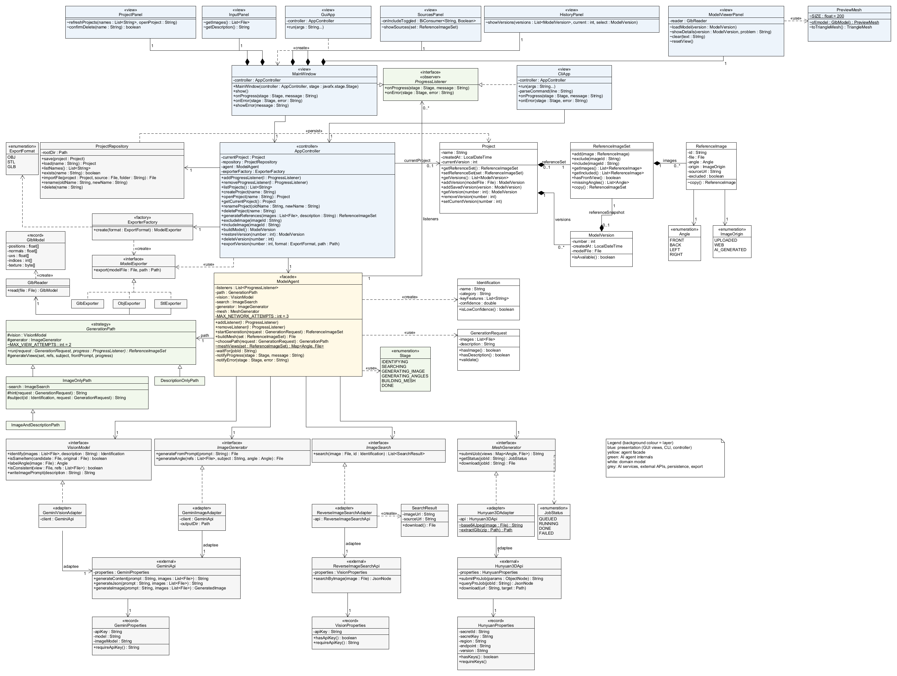
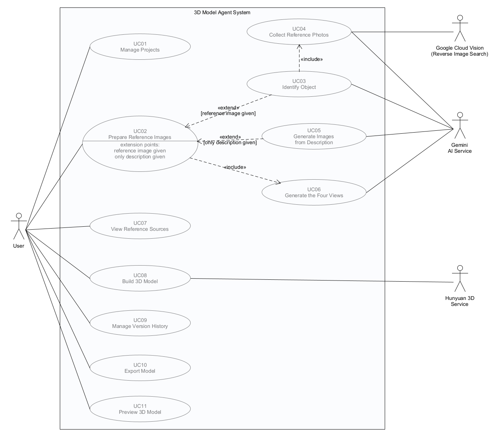
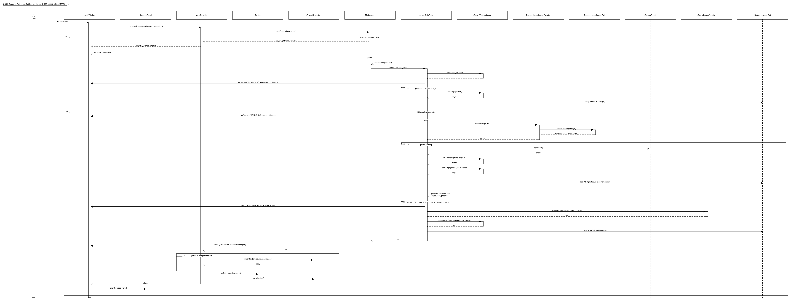
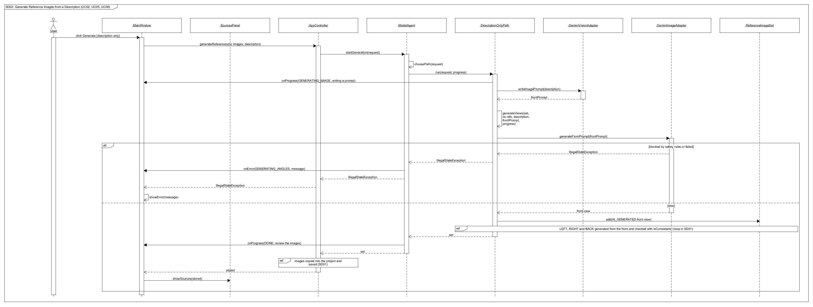
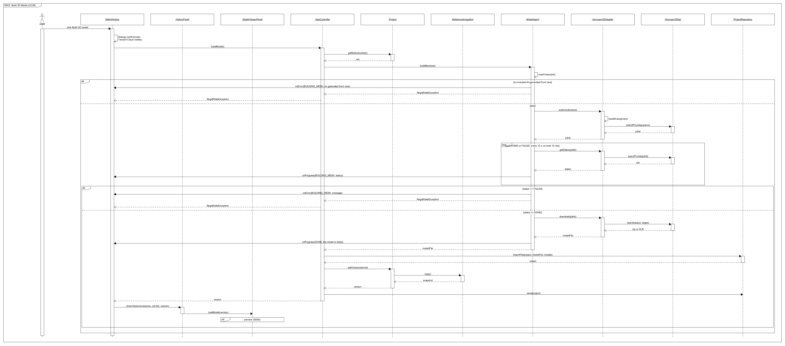
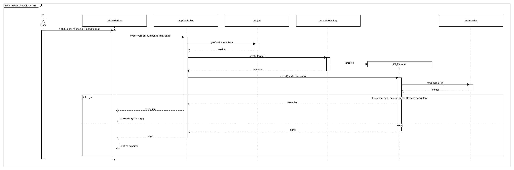
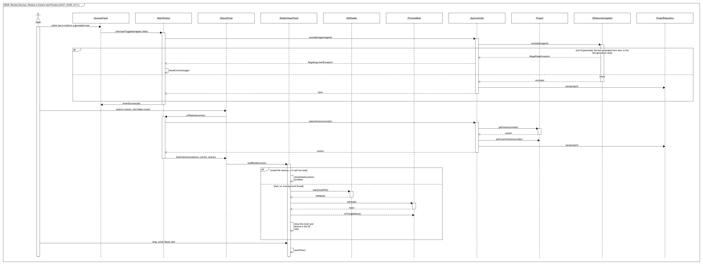

# EECS3311 Project Stage 2 Implementation Report
# AI 3D MESH GENERATOR
**Hans Kanu**

Repository: <https://github.com/Hans-Kanu/EECS3311-AI-MESH-GENERATOR> (setup and run steps are in the README).
Source code: `backend/ai-mesh-generator/src/main/java/AIMesher/ai_mesh_generator/`. File paths in this report are
relative to that folder unless they start with `backend/` or `stageDocuments/`.

---

## 1. Project Overview and Implementation Status

### 1.1 The application and its users

The AI Mesh Generator is a desktop application that turns a photo of an object, a text description, or both into a
textured 3D model. Making 3D models by hand is slow and hard to learn, and current image-to-3D services guess the
sides of an object they can't see. This application collects more information first: an AI agent works out what the
object is, searches the web for more photos of it, generates a consistent front, left, right and back view, lets the
user review them, and only then sends the views to a 3D generation service. Every model is kept as a version that can
be previewed, restored and exported.

The users are the same as in Stage 1: game developers and artists who want to speed up their work, beginners who have
ideas but not the modelling skills, and hobbyists such as people with a 3D printer who need a specific object.

The application has a **GUI** (JavaFX, the default) and a **CLI** (the same program started with the `cli` profile).
Both call the same `AppController`, so they offer the same functionality.

### 1.2 AI/LLM integration

| Service | Model / API | Used for | Class that calls it |
|---|---|---|---|
| Google Gemini (reasoning) | `gemini-3.5-flash` (setting `GEMINI_MODEL`) | The agent's "brain": identifies the object, decides whether a web photo shows the same item and which angle it shows, checks that each generated view matches the references, writes the image prompt for a description | `GeminiVisionAdapter` through `GeminiApi` |
| Google Gemini (image) | `gemini-2.5-flash-image` (setting `GEMINI_IMAGE_MODEL`) | Draws the front, left, right and back views | `GeminiImageAdapter` through `GeminiApi` |
| Google Cloud Vision | `images:annotate` with `WEB_DETECTION` | Reverse image search: finds pictures of the object online | `ReverseImageSearchAdapter` through `ReverseImageSearchApi` |
| Tencent Hunyuan 3D | Hunyuan To3D Pro job API | Builds the textured mesh (GLB) from the views | `Hunyuan3DAdapter` through `Hunyuan3DApi` |

**Why this is agent behaviour and not a single API call.** One "Generate" click runs a multi-step plan in which
later steps depend on the results of earlier ones, and the agent makes decisions along the way:

- It **plans** by choosing one of three strategies from the input (`ModelAgent.choosePath()`).
- It **reasons** about the photo (`identify()`) and **decides** from the result: an unsure identification (confidence
  below 0.6) skips the web search, because searching for the wrong item would add wrong photos.
- It **uses tools**: the reverse image search, the image downloader, the image generator and the 3D generator.
- It **checks its own work**: every web photo is checked with `isSameItem()` before it is kept, and every generated
  view with `isConsistent()`; a view that doesn't match is generated again.
- It **falls back** when a step doesn't give enough: with fewer than two matching web photos, or when the search
  fails, it explains why and generates the views from the user's input instead.
- During a build it **keeps waiting and retrying**: it polls the 3D job until it finishes and survives short network
  drops so a paid job isn't lost.

### 1.3 Architecture

The architecture is the one designed in Stage 1: MVC with a separate agent layer, and every external service behind
an interface.

```
          View: GUI (GuiApp, MainWindow + panels)        View: CLI (CliApp)
                                   \                     /
                              Controller (AppController) ----> Model (Project, ReferenceImageSet,
                                   |                             ReferenceImage, ModelVersion)
                                   |                           ProjectRepository (JSON on disk)
                        Agent Facade (ModelAgent)              ExporterFactory -> GLB / OBJ / STL
                         | runs a GenerationPath strategy
       «interface»        «interface»          «interface»          «interface»
       VisionModel        ImageSearch          ImageGenerator       MeshGenerator
            |                  |                    |                    |
    GeminiVisionAdapter  ReverseImageSearch    GeminiImageAdapter   Hunyuan3DAdapter
            |            Adapter                    |                    |
        GeminiApi        ReverseImageSearchApi  GeminiApi            Hunyuan3DApi
                         (Google Cloud Vision)                       (Tencent Cloud)
```

Spring Boot builds the objects and injects the API keys from a local, git-ignored `.env` file. The GUI starts after
Spring has built the controller (`GuiApp`); the CLI is a `CommandLineRunner` (`CliApp`).

### 1.4 Current working functionality

All eleven Stage 1 features are implemented and work in the submitted application. Six of them were changed during
implementation; each change is explained in Section 4.

| ID | Feature | Status | GUI | CLI |
|---|---|---|---|---|
| F01 | Project library | Implemented | Projects panel | `projects ...` |
| F02 | Flexible input | Implemented | 1. Input panel | `generate --image ... --describe ...` |
| F03 | Object identification | Modified | Status bar and Activity log | Progress lines |
| F04 | Reverse image search | Modified | Web photos in the review panel | Progress lines, `images list` |
| F05 | Reference source viewer | Modified | 2. Review panel | `images list / exclude / include` |
| F06 | Reference images from a description | Modified | 1. Input panel | `generate --describe ...` |
| F07 | Angle generation | Modified | 2. Review panel | `images list` |
| F08 | Multi-view mesh generation | Implemented | Build 3D model | `build` |
| F09 | Version history | Implemented | Versions panel | `versions ...` |
| F10 | Export | Implemented | Versions panel, Export... | `export ...` |
| F11 | 3D preview | Modified | 3. 3D preview panel | (visual, GUI only) |

### 1.5 Limitations and incomplete functionality

- **Late work.** The reporting periods ended on November 9 and the deadline was November 10. The GUI (F11 and the
  GUI side of every feature), GLB export, the reverse image search service (F04) and several fixes were committed on
  November 14-15. Section 6.1 lists the commits by date.
- **No confirm or accept steps (F03, F06).** Generation runs from start to finish without stopping for the user to
  confirm the identification or accept the first image. The user reviews the four views at the end instead.
- **The reverse image search (F04) often keeps no photos.** It searches by the picture only. Many shops block
  downloads, and Gemini rejects results that show a different variant, so for most objects fewer than two photos
  are kept and the agent falls back to the user's input. It needs its own Google Cloud key with billing linked; the
  first 1,000 searches each month are free.
- **Only generated views build the model (F07).** Uploaded and web photos guide the generation but are not sent to
  Hunyuan 3D, so the model depends on how well Gemini draws the four views.
- **Exports:** OBJ and STL keep the shape (and texture coordinates for OBJ) but not the textures; GLB keeps them.
- **No simplified preview** for very large models (F11). The largest real model tested (about 500,000 triangles,
  24 MB) loads in a few seconds.
- **Cost.** Each generation makes at least four image requests, and each build is a paid Hunyuan 3D job.
- **Verification** is basic, as Stage 2 requires: automated tests with fake AI services plus manual live runs.
  Deterministic system testing and KUMA agent validation are planned for Stage 3.

---

## 2. Feature to Implementation Mapping

Each feature has a mapping table, an explanation of how the classes work together from the user's input to the
result, and its type (deterministic, AI-based or hybrid). Video links are collected in Section 7.

### F01 - Project Library

| Mapping field | Entry |
|---|---|
| Feature ID and name | F01 - Project library (create, open, rename, delete) |
| Stage 1 feature/reference | F01, UC01, SD05 |
| Status or change | Implemented (saving made atomic) |
| Implemented classes/files and responsibilities | `view/ProjectPanel` (project list and buttons), `view/MainWindow` (asks for names, confirms deletes, calls the controller), `view/CliApp` (`projects` commands), `controller/AppController` (validates names, keeps the open project), `services/ProjectRepository` (stores each project as a folder with `project.json`), `model/Project` |
| Key methods | `AppController.listProjects()`, `createProject()`, `openProject()`, `renameProject()`, `deleteProject()`; `ProjectRepository.save()`, `load()`, `listNames()`, `exists()`, `rename()`, `delete()` |
| Design patterns | MVC |
| Video link/timestamp | [GUI video](https://drive.google.com/file/d/1yy99y2S9oUSBsJn07mbYF8RzKaxCJ3I_/view?usp=sharing) at 0:56; [CLI video](https://drive.google.com/file/d/1M4qvuimBaXduqeTyJu8Kn8EB1plvLA0R/view?usp=sharing) at 0:48 |

**How it works.** The user clicks New, Rename or Delete in the Projects panel (GUI), or types `projects new Stool`
(CLI). The view passes the name to `AppController`, which checks it (1-50 letters, digits, spaces, `_` or `-`) and
whether the name is taken, then asks `ProjectRepository` to create, rename or delete the project folder. Both views ask
for confirmation before a delete. `save()` writes `project.json.tmp` and then moves it over `project.json` in one step,
so a crash can't leave a half-written file, and a damaged file gives a clear error instead of a crash. Images and
models are copied inside the project folder, so a project keeps working after it is renamed.
**Type:** deterministic.

### F02 - Flexible Input (Image, Description, or Both)

| Mapping field | Entry |
|---|---|
| Feature ID and name | F02 - Flexible input |
| Stage 1 feature/reference | F02, UC02, SD01, SD02 |
| Status or change | Implemented |
| Implemented classes/files and responsibilities | `view/InputPanel` (photo list with drag and drop, description box, a hint saying which path will run), `view/CliApp` (`generate [--image <file>]... [--describe "<text>"]`), `controller/AppController` (starts generation and stores the result), `model/GenerationRequest` (checks the input), `agent/ModelAgent` (chooses the strategy), `agent/ImageOnlyPath`, `agent/DescriptionOnlyPath`, `agent/ImageAndDescriptionPath` |
| Key methods | `AppController.generateReferences(images, description)`, `GenerationRequest.validate()`, `ModelAgent.startGeneration(request)`, `ModelAgent.choosePath(request)`, `GenerationPath.run(request, progress)` |
| Design patterns | Strategy, Facade, MVC |
| Video link/timestamp | [GUI video](https://drive.google.com/file/d/1yy99y2S9oUSBsJn07mbYF8RzKaxCJ3I_/view?usp=sharing) at 2:20; [CLI video](https://drive.google.com/file/d/1M4qvuimBaXduqeTyJu8Kn8EB1plvLA0R/view?usp=sharing) at 1:27 |

**How it works.** The user adds photos and/or types a description and clicks Generate reference images. `MainWindow`
runs `AppController.generateReferences()` on a background thread so the window stays responsive. The controller wraps
the input in a `GenerationRequest` and hands it to `ModelAgent.startGeneration()`. `validate()` rejects an empty
request and files that aren't PNG, JPG or WEBP or are over 10 MB. `choosePath()` then picks `ImageOnlyPath`,
`DescriptionOnlyPath` or `ImageAndDescriptionPath`, and the chosen strategy produces the reference set. The controller
copies every image into the project and saves it. If generation fails, the project keeps its previous images.
**Type:** hybrid (deterministic checks and path choice; the paths use AI).

### F03 - Object Identification from a Reference Image

| Mapping field | Entry |
|---|---|
| Feature ID and name | F03 - Object identification |
| Stage 1 feature/reference | F03, UC03, SD01 |
| Status or change | Modified: no confirm step; the result is reported as progress (Section 4.2) |
| Implemented classes/files and responsibilities | `agent/ImageOnlyPath` (asks for the identification and decides what to do with it), `agent/ImageAndDescriptionPath` (passes the user's description as a hint and trusts it over an unsure result), `services/VisionModel` (target interface), `services/GeminiVisionAdapter` (builds the prompt and reads Gemini's JSON answer), `services/GeminiApi` (HTTP client with retries), `model/Identification` (name, category, key features, confidence) |
| Key methods | `VisionModel.identify(images, description)`, `Identification.isLowConfidence()`, `GeminiApi.generateJson(prompt, images)`, `ProgressListener.onProgress()` |
| Design patterns | Adapter, Strategy, Observer |
| Video link/timestamp | [GUI video](https://drive.google.com/file/d/1yy99y2S9oUSBsJn07mbYF8RzKaxCJ3I_/view?usp=sharing) at 3:52; [CLI video](https://drive.google.com/file/d/1M4qvuimBaXduqeTyJu8Kn8EB1plvLA0R/view?usp=sharing) at 2:18 |

**How it works.** The image paths start by calling `identify()`. `GeminiVisionAdapter` sends the photos (and the
description, if any) to Gemini and asks for a JSON answer with the name, category, key features and a confidence
between 0 and 1; a missing or malformed field is reported as an error instead of being guessed. The path reports
"Identified: name (category, N% sure)" through the agent's progress listeners, which the GUI shows in its status bar
and Activity log and the CLI prints. The identification names the object in every image prompt. With a confidence
below 0.6 the web search is skipped.
**Type:** AI-based.

### F04 - Reverse Image Search and Reference Photo Collection

| Mapping field | Entry |
|---|---|
| Feature ID and name | F04 - Reverse image search |
| Stage 1 feature/reference | F04, UC04, SD01 |
| Status or change | Modified: implemented with Google Cloud Vision, searching by the picture only (Section 4.2) |
| Implemented classes/files and responsibilities | `agent/ImageOnlyPath` (runs the search, downloads and checks results, falls back), `services/ImageSearch` (target interface), `services/ReverseImageSearchAdapter` (turns Cloud Vision's reply into `SearchResult`s), `services/ReverseImageSearchApi` (calls Cloud Vision), `services/SearchResult` (downloads one result with a size and time limit), `config/VisionProperties` (the `GOOGLE_VISION_API_KEY` setting), `services/GeminiVisionAdapter` (checks each photo) |
| Key methods | `ImageSearch.search(image, id)`, `ReverseImageSearchApi.searchByImage(image)`, `SearchResult.download()`, `VisionModel.isSameItem(candidate, original)`, `VisionModel.labelAngle(image)` |
| Design patterns | Adapter, Strategy |
| Video link/timestamp | [GUI video](https://drive.google.com/file/d/1yy99y2S9oUSBsJn07mbYF8RzKaxCJ3I_/view?usp=sharing) at 4:48; [CLI video](https://drive.google.com/file/d/1M4qvuimBaXduqeTyJu8Kn8EB1plvLA0R/view?usp=sharing) at 2:26 |

**How it works.** After a confident identification, `ImageOnlyPath` calls `ImageSearch.search()`.
`ReverseImageSearchApi` sends the user's photo to Cloud Vision's web detection. `ReverseImageSearchAdapter` lists
look-alike pictures first (they can show other angles), then pictures that contain part of the photo, each with the
page it was found on. It leaves out exact copies of the user's photo, merges duplicates and keeps only http(s)
addresses. The path downloads up to 8 results. Gemini checks each one with `isSameItem()`, and each match gets an
angle label from `labelAngle()`. With two or more matches the photos are added as WEB references (with their source
page) and given to the image generator. Otherwise, or when the search fails or no key is set, the user is told why
and the views are generated from their own input.
**Type:** hybrid (the search, download and filtering are deterministic; matching and angle labels are AI).

### F05 - Reference Source Viewer

| Mapping field | Entry |
|---|---|
| Feature ID and name | F05 - Reference source viewer |
| Stage 1 feature/reference | F05, UC07, SD06 |
| Status or change | Modified: only AI-generated views can be excluded (Section 4.2) |
| Implemented classes/files and responsibilities | `view/SourcesPanel` (a card per image with thumbnail, role, origin, source link and a "Use in build" box), `view/MainWindow` (opens links and images, passes ticks to the controller), `view/CliApp` (`images list / exclude <n> / include <n>`), `controller/AppController` (applies the change and saves), `model/ReferenceImageSet` (enforces the rules), `model/ReferenceImage` (origin, source URL, excluded flag) |
| Key methods | `SourcesPanel.showSources(set)`, `AppController.excludeImage(imageId)`, `includeImage(imageId)`, `ReferenceImageSet.exclude()`, `include()`, `hasFrontView()` |
| Design patterns | MVC |
| Video link/timestamp | [GUI video](https://drive.google.com/file/d/1yy99y2S9oUSBsJn07mbYF8RzKaxCJ3I_/view?usp=sharing) at 6:37; [CLI video](https://drive.google.com/file/d/1M4qvuimBaXduqeTyJu8Kn8EB1plvLA0R/view?usp=sharing) at 3:15 |

**How it works.** After generation, `SourcesPanel` shows every image with its origin (your photo, web photo or
AI-generated). Web photos link to the page they came from, and double-clicking a picture opens it full size. Unticking
"Use in build" on a generated view calls `AppController.excludeImage()`, which calls `ReferenceImageSet.exclude()`.
The set refuses to exclude an uploaded or web photo (they are references only), the last generated front view
(Hunyuan 3D needs a front view) or the last generated view; the refusal is shown as an error and the box goes back.
Otherwise the project is saved. `includeImage()` undoes an exclusion.
**Type:** deterministic.

### F06 - Reference Image Generation from a Description Only

| Mapping field | Entry |
|---|---|
| Feature ID and name | F06 - Reference images from a description |
| Stage 1 feature/reference | F06, UC05, SD02 |
| Status or change | Modified: all four views in one run, no Accept / Regenerate step (Section 4.2) |
| Implemented classes/files and responsibilities | `agent/DescriptionOnlyPath` (the strategy for a description alone), `services/GeminiVisionAdapter` (turns the description into an image prompt), `services/GeminiImageAdapter` (draws the front view from the prompt, then the other views) |
| Key methods | `DescriptionOnlyPath.run()`, `VisionModel.writeImagePrompt(description)`, `ImageGenerator.generateFromPrompt(prompt)`, `GenerationPath.generateViews()` |
| Design patterns | Strategy, Adapter |
| Video link/timestamp | [GUI video](https://drive.google.com/file/d/1yy99y2S9oUSBsJn07mbYF8RzKaxCJ3I_/view?usp=sharing) at 9:37 (GUI only) |

**How it works.** With only a description, `choosePath()` returns `DescriptionOnlyPath`. Gemini rewrites the
description into a detailed image prompt (`writeImagePrompt()`), the image model draws the front view from it, and
`generateViews()` draws the left, right and back views from that front (F07). If Gemini blocks the request, for
example for safety reasons, the run stops and its reason is shown, so the user can reword the description.
**Type:** AI-based.

### F07 - Angle Generation (front, left, right, back)

| Mapping field | Entry |
|---|---|
| Feature ID and name | F07 - Angle generation |
| Stage 1 feature/reference | F07 ("Missing-angle generation"), UC06, SD01, SD02 |
| Status or change | Modified: the four views are always generated; `TOP` removed (Section 4.2) |
| Implemented classes/files and responsibilities | `agent/GenerationPath` (the shared step every strategy ends with), `services/ImageGenerator` (target interface), `services/GeminiImageAdapter` (one prompt per viewpoint, saves the image), `services/GeminiVisionAdapter` (consistency check), `model/Angle` |
| Key methods | `GenerationPath.generateViews(set, refs, subject, frontPrompt, progress)`, `ImageGenerator.generateAngle(refs, subject, angle)`, `VisionModel.isConsistent(view, refs)` |
| Design patterns | Strategy (shared step), Adapter |
| Video link/timestamp | [GUI video](https://drive.google.com/file/d/1yy99y2S9oUSBsJn07mbYF8RzKaxCJ3I_/view?usp=sharing) at 5:13; [CLI video](https://drive.google.com/file/d/1M4qvuimBaXduqeTyJu8Kn8EB1plvLA0R/view?usp=sharing) at 2:31 |

**How it works.** `generateViews()` generates FRONT, LEFT, RIGHT and BACK as separate requests, in that order. The
front is made from all references (the user's photos and any web photos); every later view is made from the
references plus the generated front, so all four show the same object. `GeminiImageAdapter` describes each side view as a turn
from the attached front image, in terms of its edges ("the side at the right edge of the front image now faces the
camera"), and asks for a level camera, a plain white background and even lighting. The references set what the
object looks like but not the camera angle. Each view is
checked with `isConsistent()` for two things: that it shows the same object, and that it shows the requested side.
The front is checked against the references, the others against the front. A view that fails is generated once more (`MAX_VIEW_ATTEMPTS = 2`); if it still differs, it is kept with a warning to review it.
Only these four AI views are sent to Hunyuan 3D.
**Type:** AI-based.

### F08 - Multi-View 3D Mesh Generation

| Mapping field | Entry |
|---|---|
| Feature ID and name | F08 - Multi-view 3D mesh generation |
| Stage 1 feature/reference | F08, UC08, SD03 |
| Status or change | Implemented (network retries added) |
| Implemented classes/files and responsibilities | `view/SourcesPanel` and `MainWindow` (Build button, credit warning), `view/CliApp` (`build`), `controller/AppController` (builds and saves a version), `agent/ModelAgent` (picks the views, submits, waits, downloads), `services/MeshGenerator` (target interface), `services/Hunyuan3DAdapter` (scales and encodes the views, maps job states, extracts the GLB), `services/Hunyuan3DApi` (signed Tencent Cloud requests), `config/HunyuanProperties`, `model/Project` and `ModelVersion` |
| Key methods | `AppController.buildModel()`, `ModelAgent.buildMesh(set)`, `meshViews(set)`, `MeshGenerator.submitJob(views)`, `getStatus(jobId)`, `download(jobId)`, `Hunyuan3DApi.submitProJob()`, `queryProJob()`, `Project.addVersion(modelFile)` |
| Design patterns | Facade, Adapter, Observer, Prototype |
| Video link/timestamp | [GUI video](https://drive.google.com/file/d/1yy99y2S9oUSBsJn07mbYF8RzKaxCJ3I_/view?usp=sharing) at 7:27; [CLI video](https://drive.google.com/file/d/1M4qvuimBaXduqeTyJu8Kn8EB1plvLA0R/view?usp=sharing) at 4:21 |

**How it works.** After review, the user clicks Build 3D model (the GUI first warns that it uses Tencent Cloud
credits) or types `build`. `ModelAgent.meshViews()` takes the included AI-generated views and fails clearly when
there is no generated front view. `Hunyuan3DAdapter.submitJob()` scales each view to at most 1024 px and sends the
front as the main image and the others as extra views to Hunyuan 3D's Pro job API. The agent checks the job every 10
seconds for up to 15 minutes and reports each status to the listeners; a dropped connection while checking or
downloading is retried up to 3 times so the paid job isn't lost. The finished GLB is downloaded and copied into the
project, and `Project.addVersion()` saves it as a new current version with a deep copy of the reference set
(Prototype). The GUI then selects and previews the new version.
**Type:** hybrid (deterministic orchestration; the mesh comes from an AI model).

### F09 - Version History

| Mapping field | Entry |
|---|---|
| Feature ID and name | F09 - Version history |
| Stage 1 feature/reference | F09, UC09, SD06 |
| Status or change | Implemented |
| Implemented classes/files and responsibilities | `view/HistoryPanel` (newest-first list with Make current, Delete and Export), `view/CliApp` (`versions list / restore / delete`), `controller/AppController`, `model/Project` (versions and the current one), `model/ModelVersion` (number, time, model file, reference snapshot) |
| Key methods | `AppController.restoreVersion(number)`, `deleteVersion(number)`, `Project.setCurrentVersion()`, `removeVersion()`, `getVersion()`, `ModelVersion.isAvailable()` |
| Design patterns | Prototype (each version keeps its own reference set), MVC |
| Video link/timestamp | [GUI video](https://drive.google.com/file/d/1yy99y2S9oUSBsJn07mbYF8RzKaxCJ3I_/view?usp=sharing) at 7:51; [CLI video](https://drive.google.com/file/d/1M4qvuimBaXduqeTyJu8Kn8EB1plvLA0R/view?usp=sharing) at 4:46 |

**How it works.** The Versions panel lists every version with its build time and marks the current one. Selecting a
version previews it (F11). Make current calls `restoreVersion()`, which refuses a version whose model file is missing
and otherwise saves it as current. Delete asks for confirmation first; deleting the current version makes the newest
remaining one current. The CLI offers the same through `versions list`, `versions restore <n>` and
`versions delete <n>`.
**Type:** deterministic.

### F10 - Model Export (GLB / OBJ / STL)

| Mapping field | Entry |
|---|---|
| Feature ID and name | F10 - Model export |
| Stage 1 feature/reference | F10, UC10, SD04 |
| Status or change | Implemented |
| Implemented classes/files and responsibilities | `view/MainWindow` (file chooser with GLB, OBJ and STL filters), `view/CliApp` (`export <n> --format glb|obj|stl --out <file>`, asks before overwriting), `controller/AppController`, `exporter/ExporterFactory` (picks the exporter), `exporter/ModelExporter` (common interface), `exporter/GlbExporter` (copies the GLB with its textures), `exporter/ObjExporter` and `exporter/StlExporter` (convert the mesh), `exporter/GlbReader` and `GlbModel` (read the GLB) |
| Key methods | `AppController.exportVersion(number, format, path)`, `ExporterFactory.create(format)`, `ModelExporter.export(modelFile, path)`, `GlbReader.read(file)` |
| Design patterns | Factory |
| Video link/timestamp | [GUI video](https://drive.google.com/file/d/1yy99y2S9oUSBsJn07mbYF8RzKaxCJ3I_/view?usp=sharing) at 8:38; [CLI video](https://drive.google.com/file/d/1M4qvuimBaXduqeTyJu8Kn8EB1plvLA0R/view?usp=sharing) at 5:40 |

**How it works.** The user picks a version and a file. The format comes from the chosen filter or the file's
extension (`MainWindow.formatOf()`), and the CLI adds the right extension if it's missing. The controller asks
`ExporterFactory` for the exporter and calls `export()`. GLB is copied as is. OBJ and STL read the GLB with
`GlbReader`, which applies each node's transform, and write the triangles: OBJ with normals and texture coordinates,
STL as binary with Z pointing up for 3D printing. Overwriting an existing file needs confirmation.
**Type:** deterministic.

### F11 - 3D Model Preview Viewer

| Mapping field | Entry |
|---|---|
| Feature ID and name | F11 - 3D preview (turn, zoom, reset) |
| Stage 1 feature/reference | F11, UC11, SD06 |
| Status or change | Modified: takes the version; no simplified preview (Section 4.2) |
| Implemented classes/files and responsibilities | `view/ModelViewerPanel` (JavaFX 3D view, mouse controls, details line), `view/PreviewMesh` (centres and scales the mesh, converts glTF to JavaFX axes, computes normals if missing), `exporter/GlbReader` (reads geometry and the base colour texture) |
| Key methods | `ModelViewerPanel.loadModel(version)`, `showDetails(version, problem)`, `resetView()`, `GlbReader.read(file)`, `PreviewMesh.of(model)`, `toTriangleMesh()` |
| Design patterns | MVC |
| Video link/timestamp | [GUI video](https://drive.google.com/file/d/1yy99y2S9oUSBsJn07mbYF8RzKaxCJ3I_/view?usp=sharing) at 7:58 (GUI only) |

**How it works.** Selecting a version (or finishing a build) calls `loadModel(version)`. The GLB is read on a
background thread, converted by `PreviewMesh` and shown with its texture in a JavaFX `SubScene`. Dragging turns the
model, scrolling zooms and Reset view returns to the starting angle; a details line shows the triangle count and
file size. If the model file is missing or can't be read, `showDetails()` explains why and shows what is known about
the version, which can still be exported. The CLI has no preview because it is text only.
**Type:** deterministic.

---

## 3. Implemented Design Patterns

Six patterns from the course are implemented, the same six as in Stage 1: Facade, Adapter, Strategy, Observer,
Factory and Prototype. MVC is the overall architecture and is not counted. None was replaced; the changes are in the
participants and method signatures and are explained in each subsection.

### 3.1 Facade

- **Design problem.** Making the reference set takes many steps across four services (identify, search, download and
  check, generate four views and check each one), and building a mesh means submitting a job, polling it, retrying
  network errors and downloading. If the controller ran all this, it would depend on every service and the order of
  every step.
- **Participants.** Facade: `ModelAgent`. Subsystem: `VisionModel`, `ImageSearch`, `ImageGenerator`,
  `MeshGenerator` and the `GenerationPath` strategies. Client: `AppController`.
- **Files and methods.** `agent/ModelAgent.java`: `startGeneration(request) : ReferenceImageSet`,
  `buildMesh(set) : File`, `addListener()`, `removeListener()`. `controller/AppController.java`:
  `generateReferences()`, `buildModel()`.
- **How it follows the pattern.** `AppController` makes two calls and never sees a service. Everything else
  (choosing the path, the order of the steps, fallbacks, retries and progress reporting) happens inside the facade.
- **Compared with Stage 1.** Same role. The public interface shrank from five calls (`identifyObject()`,
  `collectReferences()`, `generateFromDescription()`, `fillMissingAngles()`, `buildMesh()`) to two, because the step
  methods moved into the strategies. This hides more from the client, which is the point of a facade.

### 3.2 Adapter

- **Design problem.** Each provider has its own request format, authentication and reply format: Gemini's
  `generateContent`, Cloud Vision's `images:annotate`, and Tencent's signed job API with its own job states. The agent
  shouldn't depend on any of them.
- **Participants.** Targets: `VisionModel`, `ImageSearch`, `ImageGenerator`, `MeshGenerator`. Adapters:
  `GeminiVisionAdapter`, `ReverseImageSearchAdapter`, `GeminiImageAdapter`, `Hunyuan3DAdapter`. Adaptees: `GeminiApi`,
  `ReverseImageSearchApi`, `Hunyuan3DApi`. Client: `ModelAgent` and the strategies.
- **Files and methods.** `services/*Adapter.java`. For example, `Hunyuan3DAdapter.submitJob(views)` scales and
  encodes the images and calls `Hunyuan3DApi.submitProJob(params)`; `getStatus()` maps Tencent's `WAIT`, `RUN`
  and `DONE` to `JobStatus` and turns `FAIL` into an error that carries Tencent's reason. `ReverseImageSearchAdapter.search()` turns the `webDetection` JSON into
  `SearchResult`s. `GeminiVisionAdapter.identify()` turns Gemini's JSON into an `Identification`.
- **How it follows the pattern.** Each adapter implements the system's interface and holds the client it wraps
  (object adapter). The tests replace the adapters with fakes, so the agent is tested without paid calls.
- **Compared with Stage 1.** As designed. `GeminiVisionAdapter` and `GeminiImageAdapter` share one `GeminiApi`
  client. The adaptees' methods match the real APIs: `submitProJob()` and `queryProJob()` instead of `createJob()`
  and `queryJob()`, and `searchByImage()` returns the parsed `JsonNode`. Cloud Vision was chosen as the search adaptee
  (Section 4.2, F04).

### 3.3 Strategy

- **Design problem.** The steps depend on the input (F02): a photo needs identification and a web search, a
  description alone needs a prompt first, and both use the description to steer identification.
- **Participants.** Strategy: `GenerationPath` (abstract). Concrete strategies: `ImageOnlyPath`,
  `DescriptionOnlyPath`, `ImageAndDescriptionPath`. Context: `ModelAgent`, which chooses in `choosePath()`, stores
  the choice in `path` and runs it from `startGeneration()`.
- **Files and methods.** `agent/GenerationPath.java`: `run(request, progress) : ReferenceImageSet` (abstract) and
  the shared `generateViews(...)`. `agent/ImageOnlyPath.java`: `run()`, `hint()`, `subject()`. `agent/ImageAndDescriptionPath.java` overrides
  `hint()` and `subject()`.
- **How it follows the pattern.** Each strategy is its own class with the same `run()` signature, and the context
  picks one at run time. Every strategy ends with the shared `generateViews()`.
- **Compared with Stage 1.** The pattern is the same; two details changed. `run()` no longer receives the agent:
  each strategy holds the services it needs and reports progress to a `ProgressListener`, so strategies don't call
  back into the facade. `ImageAndDescriptionPath` extends `ImageOnlyPath`, because it runs the same steps and only
  changes the hint and the subject passed to the image generator. Subclassing avoids copying those steps.

### 3.4 Observer

- **Design problem.** Generation and building take minutes. Both views need live progress and errors, and the agent
  must not know which views exist.
- **Participants.** Subject: `ModelAgent` (`listeners`, `addListener()`, `removeListener()`, `notifyProgress()`,
  `notifyError()`). Observer: `ProgressListener` (`onProgress(stage, message)`, `onError(stage, error)`). Concrete
  observers: `MainWindow` and `CliApp`, registered through `AppController.addProgressListener()`.
- **Files and methods.** `agent/ProgressListener.java`, `agent/Stage.java`, `agent/ModelAgent.java`
  (inner class `Broadcaster`), `view/MainWindow.java`, `view/CliApp.java`.
- **How it follows the pattern.** The agent sends updates to whoever registered. `MainWindow` moves each update to
  the JavaFX thread (`Platform.runLater`) and shows it in the status bar and Activity log; `CliApp` prints it.
- **Compared with Stage 1.** Same participants. The strategies report through the agent's inner `Broadcaster`, which
  forwards every update and remembers the current stage, so an error is reported at the stage where it happened.
  `removeProgressListener()` was added so a closed view stops receiving updates.

### 3.5 Factory

- **Design problem.** The export format is only known when the user picks it, and each format needs a different
  exporter. Without a factory, both views (or the controller) would switch on the format and depend on every class.
- **Participants.** Factory: `ExporterFactory`. Product interface: `ModelExporter`. Products: `GlbExporter`,
  `ObjExporter`, `StlExporter`. Client: `AppController`.
- **Files and methods.** `exporter/ExporterFactory.create(format)`, `ModelExporter.export(modelFile, path)`,
  `AppController.exportVersion()`.
- **How it follows the pattern.** The controller asks for an exporter by `ExportFormat` and uses it only through
  `ModelExporter`.
- **Compared with Stage 1.** As designed. `ObjExporter` and `StlExporter` share one `GlbReader` (also used by the
  preview), and `GlbExporter` copies the file.

### 3.6 Prototype

- **Design problem.** Each version must keep the exact images it was built from, even after the user regenerates or
  excludes images later. Rebuilding that set would repeat slow and paid generation.
- **Participants.** Prototype: `ReferenceImageSet` (and `ReferenceImage`). Client: `Project.addVersion()`. Result:
  the version's `referenceSnapshot`.
- **Files and methods.** `model/ReferenceImageSet.copy()`, `model/ReferenceImage.copy()`, `model/Project.addVersion()`,
  `model/ModelVersion.getReferenceSnapshot()`.
- **How it follows the pattern.** The set copies itself, including each image's origin, source and excluded flag.
  The copy is deep, so later changes to the working set don't change older versions.
- **Compared with Stage 1.** As designed, plus `ReferenceImage.copy()` so each image copies itself.

### 3.7 Updated UML class diagram

The class diagram was updated to the implemented classes and methods. Section 4.3 lists the changes; the main ones
are `GuiApp` (replacing `IdentificationPanel`), `PreviewMesh`, `GlbReader`, `GlbModel` and the three configuration
records.



_Source: [diagrams/class_diagram.uxf](diagrams/class_diagram.uxf) (UMLet)._

### 3.8 Updated use-case diagram and descriptions

In the use-case diagram, the search actor is now Google Cloud Vision, and UC06 is renamed "Generate the Four Views"
because all four views are always generated.



The use cases whose flows changed are rewritten below. UC01, UC02, UC08, UC09 and UC10 still match the
implementation, except that UC02 step 5 is now the review of the four views in UC07 (there is no separate accept step)
and UC08 is only started by the user.

#### UC03 - Identify Object (updated)
| Field | Details |
|---|---|
| **Actor(s)** | Gemini AI Service |
| **Goal** | Work out what object is in the reference image. |
| **Preconditions** | The user gave at least one reference image. |
| **Trigger** | UC02 reaches "reference image given". |
| **Main Success Scenario** | 1. The agent sends the image(s), and the description if given, to Gemini. <br> 2. Gemini returns the object's name, category, key features and confidence. <br> 3. The result is shown as a progress message. <br> 4. More photos are collected (UC04). |
| **Alternative / Exception Flows** | 2a. Low confidence (below 0.6): the user is told, the search is skipped and the views are generated from the user's input. <br> 2b. Gemini is busy or unreachable: requests are retried with backoff; if they still fail, the error is shown and the project's images are unchanged. |
| **Postconditions** | The identification names the object in the image prompts. |
| **Related Feature(s)** | F03 |

#### UC04 - Collect Reference Photos (updated)
| Field | Details |
|---|---|
| **Actor(s)** | Google Cloud Vision, Gemini AI Service |
| **Goal** | Find more photos of the same object online. |
| **Preconditions** | The object was identified with enough confidence (UC03). |
| **Trigger** | Included by UC03. |
| **Main Success Scenario** | 1. The agent sends the user's photo to Cloud Vision's web detection. <br> 2. Up to 8 results are downloaded. <br> 3. Gemini keeps the photos that show the same item and labels their angle. <br> 4. With two or more matches, they are added as web references with their source page. |
| **Alternative / Exception Flows** | 1a. No Vision key, or the service fails: the user is told the web wasn't searched and the views are generated from their input. <br> 2a. A result can't be downloaded: it is skipped. <br> 4a. Fewer than two matches: they aren't used; the user is told why. |
| **Postconditions** | The set contains the matching web photos, if any, with their sources. |
| **Related Feature(s)** | F04 |

#### UC05 - Generate Images from Description (updated)
| Field | Details |
|---|---|
| **Actor(s)** | Gemini AI Service |
| **Goal** | Create the views from a description alone. |
| **Preconditions** | The user gave only a description. |
| **Trigger** | UC02 reaches "only description given". |
| **Main Success Scenario** | 1. Gemini turns the description into an image prompt. <br> 2. The image model draws the front view. <br> 3. The other views are generated from the front (UC06). |
| **Alternative / Exception Flows** | 2a. The request is blocked or fails: the run stops with Gemini's reason so the user can reword the description. |
| **Postconditions** | The set has four AI-generated views. To get different images, the user edits the description and generates again. |
| **Related Feature(s)** | F06 |

#### UC06 - Generate the Four Views (updated, renamed from "Generate Missing Angles")
| Field | Details |
|---|---|
| **Actor(s)** | Gemini AI Service |
| **Goal** | Produce a consistent front, left, right and back view for the 3D generator. |
| **Preconditions** | The references (user photos, web photos) or a front-view prompt are ready. |
| **Trigger** | Included by UC02. |
| **Main Success Scenario** | 1. The front view is generated from the references. <br> 2. Left, right and back are generated from the references plus the front. <br> 3. Each view is checked for consistency and added to the set. |
| **Alternative / Exception Flows** | 3a. A view doesn't match: it is generated once more. <br> 3b. It still doesn't match: it is kept and the user is warned to review it. |
| **Postconditions** | The set has four AI-generated views; uploaded and web photos stay as references only. |
| **Related Feature(s)** | F07 |

#### UC07 - View Reference Sources (updated)
| Field | Details |
|---|---|
| **Actor(s)** | User |
| **Goal** | See where each image came from and choose which generated views build the model. |
| **Preconditions** | The project has a reference set. |
| **Trigger** | Generation finishes, the user opens a project, or the user runs `images list`. |
| **Main Success Scenario** | 1. Each image is shown with its origin, and web photos with their source page. <br> 2. The user unticks any generated view they don't want sent. <br> 3. The set is updated and saved. |
| **Alternative / Exception Flows** | 2a. The image is an uploaded or web photo: the action is refused, since those are references only. <br> 2b. It is the last generated front view or the last generated view: the action is refused with the reason. <br> 2c. The user ticks an excluded view again: it is included. |
| **Postconditions** | The set reflects the user's choices. |
| **Related Feature(s)** | F05 |

#### UC11 - Preview 3D Model (updated)
| Field | Details |
|---|---|
| **Actor(s)** | User |
| **Goal** | Inspect the model from every side before exporting. |
| **Preconditions** | The project has at least one version. |
| **Trigger** | A build finishes, or the user selects a version. |
| **Main Success Scenario** | 1. The version's model is loaded with its texture. <br> 2. The user drags to turn it and scrolls to zoom. <br> 3. Reset view returns to the starting angle. |
| **Alternative / Exception Flows** | 1a. The model file is missing or can't be read: the reason and the version's details are shown instead; it can still be exported. |
| **Postconditions** | No data changes. |
| **Related Feature(s)** | F11 |

### 3.9 Updated sequence diagrams

SD01, SD02, SD03, SD04 and SD06 were redrawn with the implemented methods. SD05 (managing projects through the CLI)
still matches the code and is unchanged from Stage 1.

**SD01 - Generate Reference Set from an Image (UC02, UC03, UC04, UC06).** No confirm step; search by picture through
Cloud Vision; four generated views; the images copied into the project.



**SD02 - Generate Reference Images from a Description (UC02, UC05, UC06).** No Accept step; the front view comes from
the prompt Gemini writes.



**SD03 - Build 3D Model (UC08).** `meshViews()` checks for a generated front view; the job is polled with
`queryProJob()`; `buildModel()` returns the new version, which the GUI selects and previews.



**SD04 - Export Model (UC10).** Errors return to `MainWindow` as exceptions; the exporter reads the GLB with
`GlbReader`.



**SD06 - Review Sources, Restore a Version and Preview (UC07, UC09, UC11).** The new exclusion rule, Make current,
and the preview loading the model through `GlbReader` and `PreviewMesh`.



---

## 4. Changes and Rationale

No feature was added, removed or replaced; six were modified. No pattern was added or replaced.

### 4.1 Consolidated record (Original design -> Implemented change -> Reason -> Impact)

| Original design | Implemented change | Reason | Impact |
|---|---|---|---|
| **F03:** "Identified as" panel; user confirms or corrects (`IdentificationPanel`, `confirmIdentification()`) | Identification shown as a progress message; no confirm step | Generation runs as one background call, so it never waits halfway for the user | UC03, SD01; `IdentificationPanel` not implemented |
| **F04:** a reverse image search service behind `ReverseImageSearchAdapter`, by keywords and/or image | Google Cloud Vision web detection, by picture only; own key `GOOGLE_VISION_API_KEY` | Takes the uploaded file itself, free for 1,000 searches a month; doesn't accept text; refuses Gemini keys | UC04, SD01; `VisionProperties` added |
| **F05:** any image can be excluded | Only AI-generated views can be excluded; `includeImage()` undoes it | Only generated views are sent to Hunyuan 3D | UC07, SD06; `ReferenceImageSet.exclude()` |
| **F06:** one image with Accept / Regenerate | Four views in one run; edit the description and generate again to redo | Same as F03; all four views are reviewed together | UC05, SD02; `acceptGeneratedImage()`, `regenerateImage()` not implemented |
| **F07:** generate only the missing angles, including TOP | Always generate FRONT, LEFT, RIGHT, BACK; photos are references only; TOP removed | Photos differ in lighting, scale and variant; Hunyuan 3D takes no top view | UC06, SD01, SD02; `generateViews()` replaces `fillAndReview()` |
| **F08:** build may start when the set is accepted | Build only on the user's command; network drops retried | The user always reviews first; protects paid jobs | UC08, SD03 |
| **F11:** `loadModel(modelFile)`, simplified preview for large models | `loadModel(version)`; no simplified preview | Details can be shown when loading fails; real models load fast enough | UC11, SD03, SD06 |
| **Architecture:** GUI technology not chosen | JavaFX GUI started by `GuiApp` after Spring builds the controller; `gui` is the default profile and `cli` is chosen with `--spring.profiles.active=cli` | One program, one controller, two views | README run commands |
| **Facade** with five step methods | Two calls: `startGeneration(request)`, `buildMesh(set)` | Steps moved into the strategies | `AppController` simpler |
| **Strategy:** `run(agent, request, set)`; three independent paths | `run(request, progress)`; `ImageAndDescriptionPath extends ImageOnlyPath` | Strategies hold their services; avoids copying the image path's steps | SD01, SD02 |
| **Observer:** agent notifies listeners | Inner `Broadcaster` remembers the stage; `removeProgressListener()` | Errors reported at the right stage; closed views detach | Both views |

### 4.2 Modified features in detail

#### F03 Object identification (Modified)
1. **Original:** F03 / UC03. The identification appears in an "Identified as" panel (`IdentificationPanel`), where
   the user confirms or corrects it (`AppController.confirmIdentification()`). For a low-confidence result, the user
   is asked for a description and the search is skipped.
2. **Implemented:** `ImageOnlyPath.run()` calls `VisionModel.identify()` and reports "Identified: name (category, N%
   sure)" through `onProgress()`. A low-confidence result skips the search without asking.
3. **What changed and why:** The pipeline runs as one background call (`AppController.generateReferences()`), so it
   never stops halfway. Pausing would need the agent to keep state between two controller calls, plus two extra
   dialogs in both views. The identification only steers the image prompts, and the user reviews the generated views
   anyway (F05), which is where a wrong identification becomes visible.
4. **User need:** The user still sees what the agent thinks the object is. To correct it, they add or change the
   description and generate again; `ImageAndDescriptionPath` then trusts the description over an unsure result.
5. **Affected:** UC03 (confirm step removed); SD01; `IdentificationPanel` (not implemented),
   `AppController.submitRequest()` and `confirmIdentification()` (replaced by `generateReferences()`). No pattern
   change.

#### F04 Reverse image search (Modified)
1. **Original:** F04 / UC04. `ReverseImageSearchAdapter` wraps `ReverseImageSearchApi` behind `ImageSearch`; the
   search may use keywords, the image, or both, depending on the service. Matches are checked with `isSameItem()`.
2. **Implemented:** `ReverseImageSearchApi.searchByImage()` calls Cloud Vision `WEB_DETECTION`;
   `ReverseImageSearchAdapter` turns the reply into `SearchResult`s (look-alikes first, exact copies left out,
   duplicates merged); `ImageOnlyPath` downloads up to 8, keeps matches and falls back with fewer than 2.
3. **What changed and why:** Search by picture only, because Cloud Vision takes no text. It accepts the uploaded file
   itself (most image search APIs need a public URL) and is free for the first 1,000 searches a month. It needs its
   own key, since Cloud Vision refuses Gemini keys from AI Studio, and billing linked to the key's project.
   `searchByImage()` returns parsed JSON (`JsonNode`) instead of a `String`.
4. **User need:** As designed: photos of the same item are collected, checked and shown with their source page. Without
   a key the app still works and says the web wasn't searched.
5. **Affected:** UC04, SD01; `ReverseImageSearchAdapter`, `ReverseImageSearchApi`, `VisionProperties` (new). Adapter
   as designed.

#### F05 Reference source viewer (Modified)
1. **Original:** F05 / UC07. A Sources tab shows each photo with its origin, a source link and an Exclude checkbox.
2. **Implemented:** `SourcesPanel` shows a card per image with thumbnail, role, origin and link; CLI `images list /
   exclude / include`. `ReferenceImageSet.exclude()` refuses to lose the last generated front view or the last
   generated view.
3. **What changed and why:** Only AI-generated views go to Hunyuan 3D (F07), so only they can be excluded; uploaded
   and web photos are refused with "references only". Only a generated front counts as the front view. Before this
   rule, an uploaded photo labelled "front" made the generated front look optional, and the build then failed.
   `AppController.includeImage()` was added so an exclusion can be undone.
4. **User need:** The user still sees where every image came from and controls which views build the model.
5. **Affected:** UC07, SD06; `SourcesPanel`, `AppController.includeImage()`, `ReferenceImageSet.exclude()`,
   `include()`, `hasFrontView()`.

#### F06 Reference image generation from a description (Modified)
1. **Original:** F06 / UC05. The agent writes a prompt, generates one image and shows it with Accept and Regenerate
   (`acceptGeneratedImage()`, `regenerateImage()`).
2. **Implemented:** `DescriptionOnlyPath.run()` gets a prompt from `writeImagePrompt()`, generates the front with
   `generateFromPrompt()`, then the other three views, in one run. A blocked request stops the run with Gemini's
   reason.
3. **What changed and why:** Same reason as F03: one uninterrupted run. Reviewing all four views together (F05)
   replaces accepting the first one.
4. **User need:** To regenerate, the user edits the description and clicks Generate again; built versions keep their
   own images.
5. **Affected:** UC05, SD02; `acceptGeneratedImage()`, `regenerateImage()` (not implemented);
   `ModelAgent.generateFromDescription()` moved into `DescriptionOnlyPath.run()`.

#### F07 Angle generation (Modified)
1. **Original:** F07 / UC06. The agent finds which angles (front, back, left, right, top) are missing from the
   uploaded and web photos and generates only those.
2. **Implemented:** `GenerationPath.generateViews()` always generates FRONT, then LEFT, RIGHT and BACK, each checked
   with `isConsistent()` and generated again once if it doesn't match. Only these views go to Hunyuan 3D
   (`ModelAgent.meshViews()`).
3. **What changed and why:** Web and uploaded photos differ in lighting, background, scale and product variant, and
   are rarely exact front or side shots. A generated set is consistent and always covers the four views Hunyuan 3D's
   multi-view input takes. Hunyuan 3D has no top view input, so `Angle.TOP` was removed. Two attempts instead of
   three limits paid image generations.
4. **User need:** The user still gets a complete, consistent multi-view set. Each run costs at least four image
   generations.
5. **Affected:** UC06 (renamed), SD01, SD02; `generateViews()` (replaces `fillAndReview()`), `Angle`,
   `ImageGenerator.generateAngle(refs, subject, angle)` (gained `subject`), `ModelAgent.meshViews()`. Strategy is
   unchanged; `generateViews()` is the shared step.

#### F11 3D preview (Modified)
1. **Original:** F11 / UC11. `ModelViewerPanel.loadModel(modelFile)`; a large model gets a simplified preview; a model
   that can't be shown shows the version's details instead.
2. **Implemented:** `loadModel(version)` reads the GLB with `GlbReader` on a background thread, converts it with
   `PreviewMesh` and shows it with its texture. A missing or unreadable model calls `showDetails(version, problem)`.
3. **What changed and why:** `loadModel()` takes the version so it can show the version's details on failure. There is
   no simplified preview because a real 500,000-triangle, 24 MB model loads in a few seconds.
4. **User need:** As designed.
5. **Affected:** UC11, SD03, SD06; `ModelViewerPanel`, `PreviewMesh`, `GlbReader`, `GlbModel`.

### 4.3 Class and method changes

| Original design | Implemented change | Reason | Impact |
|---|---|---|---|
| `AppController.submitRequest()`, `confirmIdentification()`, `acceptGeneratedImage()`, `regenerateImage()` | `generateReferences(images, description) : ReferenceImageSet` | One uninterrupted run (F03, F06) | Views make one call; images copied into the project |
| `AppController.buildModel()` | Returns the new `ModelVersion` | The views show and select it | GUI previews it right away |
| (none) | `AppController.includeImage()`, `removeProgressListener()`, `getCurrentProject()` | Undo an exclusion; detach a closed view; views read the open project | Both views |
| `ModelAgent.startGeneration(request, set)` | `startGeneration(request) : ReferenceImageSet` | The path builds a new set; the controller decides where it goes | The project keeps its old set if generation fails |
| `ModelAgent.maxRetries = 3` | `GenerationPath.MAX_VIEW_ATTEMPTS = 2`; `ModelAgent.MAX_NETWORK_ATTEMPTS = 3` | Each retry is a paid image; network retries protect paid jobs | F07, F08 |
| `GenerationPath.run(agent, request, set)`, `fillAndReview()` | `run(request, progress)`, `generateViews(set, refs, subject, frontPrompt, progress)` | Strategies use their services directly | SD01, SD02 |
| `Angle` with `TOP` | FRONT, BACK, LEFT, RIGHT | Hunyuan 3D takes no top view | F07 |
| `ImageGenerator.generateAngle(refs, angle)` | `generateAngle(refs, subject, angle)`; for a side view the first reference is the front | The prompt names the object, and side views are described as a turn from the front | `GeminiImageAdapter` |
| `VisionModel.isConsistent(view, refs)` | `isConsistent(view, refs, angle)`: checks the object and the viewpoint | Checking only the object let a copy of the front pass as every side | `GeminiVisionAdapter`, `GenerationPath` |
| `GeminiApi.generateContent()` | Plus `generateJson()`, `generateImage()`; retries busy errors with backoff; 120 s timeout | Structured answers and images need different requests; models are often busy | Clear "busy" vs "no connection" messages |
| `Hunyuan3DApi.createJob()`, `queryJob()` | `submitProJob()`, `queryProJob()`, `download()`, signed with TC3-HMAC-SHA256 | Matches Tencent's Pro job API | `Hunyuan3DAdapter` maps `JobStatus` |
| `ReverseImageSearchApi.searchByImage() : String` | `searchByImage() : JsonNode` via Cloud Vision; `VisionProperties` | See F04 | F04 needs its own key |
| `ProjectRepository` | Plus `importFile()`; atomic save; damaged files give a clear error | Images and models live in the project folder; no half-written saves | F01, F09 |
| `Project`, `ReferenceImageSet`, `ReferenceImage` | Plus `Project.setReferenceSet()`, `addSavedVersion()`; `ReferenceImageSet.include()`, `getImages()`; `ReferenceImage.copy()`; `ModelVersion.isAvailable()` | Loading saved projects, undoing exclusions, deep copies, missing files | Model classes |
| `IdentificationPanel` | Not implemented | See F03 | GUI has five panels |
| `InputPanel.getRequest()`, `showPath()` | `getImages()`, `getDescription()`; the hint updates as the user types | `MainWindow` passes images and text to the controller | F02 |
| `SourcesPanel.onExcludeToggled(imageId)` | A callback with `(imageId, included)` | Ticking and unticking use one handler | F05 |
| `HistoryPanel.showVersions(versions)`, `ProjectPanel.refreshProjects(names)` | Also take the current version / open project | The lists highlight the current item | F01, F09 |
| `ModelViewerPanel.loadModel(modelFile)` | `loadModel(version)`, `showDetails(version, problem)`, `clear(text)` | See F11 | F11 |
| (none) | New: `GuiApp`, `Dialogs`, `PreviewMesh` | GUI start-up, shared pop-ups, preview conversion | Presentation layer |
| (none) | New: `GeminiProperties`, `HunyuanProperties`, `VisionProperties`, `GlbReader`, `GlbModel` | Keys from `.env`; one GLB parser for export and preview | Services and export layers |

### 4.4 Pattern changes

No pattern was added, replaced or removed, so items 6-10 of the Stage 2 instructions apply only as modifications.
They are covered in Sections 3.1 (Facade's smaller interface), 3.3 (Strategy's new `run()` signature and
`ImageAndDescriptionPath extends ImageOnlyPath`) and 3.4 (Observer's `Broadcaster`). In each case the original
pattern, its role and the architecture stay the same.

---

## 5. AI Tools and Collaboration Log

### 5.1 Tools used

| Tool or platform | LLM / model | Features, classes or tasks | Total tokens | Money cost |
|---|---|---|---|---|
| Claude Code (CLI) | Claude Opus 5.5 (607 replies); Claude Haiku 5.5 for one helper agent (8 replies) | Implementation and tests across all features: agent and strategies, adapters and API clients, CLI, JavaFX GUI and preview, exporters; debugging; README, change record and UML diagram updates | 112.6 M in total: 800,536 output, 1,780,435 written to the prompt cache, 110,064,226 read from the cache, 1,478 other input | Claude Pro subscription, $20 a month (flat fee, not billed per token); used from late October to mid-November |

Token totals are summed from Claude Code's local session logs for this project (six sessions, October 26 to
November 15). Most tokens are cache reads, because every request re-reads the conversation so far from the cache.

The AI services the application itself calls at run time are not development tools, but they were used and paid for
during development and testing:

| Service | Model / API | Usage during development | Money cost |
|---|---|---|---|
| Google Gemini | `gemini-3.5-flash`, `gemini-2.5-flash-image` | Identification, checks and view generation in test runs | $3.29 for the month |
| Google Cloud Vision | `images:annotate`, web detection | 17 requests | $0 (within the 1,000 free requests a month) |
| Tencent Hunyuan 3D | To3D Pro job API | 3 build jobs | 35 points |

### 5.2 Representative interactions

Each interaction below shows what was asked, what the AI produced, and what I checked or changed.

| # | Task | What the AI did | Human review and decision |
|---|---|---|---|
| 1 | JavaFX GUI (all features, F11) | Built `MainWindow`, the panels and the 3D preview; found that Spring Boot 4 ignores `spring.profiles.default` and set the default profile in `main()` instead | The GUI was checked on a real project, and the preview camera (too close, seen from below) and cut-off buttons were fixed |
| 2 | Code audit | Audited the repository and found that excluding a generated front view was allowed when an uploaded photo was labelled "front", so the build then failed | I chose which findings to fix; this one became "only generated views can be excluded", with regression tests |
| 3 | Reverse image search (F04) | Implemented Cloud Vision web detection; the first live call failed with 401 because Gemini keys aren't accepted, then with 403 until billing was linked | I created a separate Vision key and linked billing; both errors now say how to fix them |
| 4 | Views looking the same (F07) | Found three causes in testing: "the object's left" was read as the viewer's left, the prompt told the model to keep the references "exactly", and the check only asked whether it was the same object. Rewrote the viewpoint prompts against the front image and added a viewpoint check | I reported the problem from the GUI (a mug and a doughnut) and checked the new views in a live run: the mug's handle now moves to the correct side in each view |
| 5 | UML update | Rewrote the class and sequence diagrams from the code and rendered them with UMLet; the first render showed a parse error in SD01 and SD03, which it fixed | The rendered diagrams were checked against the code before committing |
| 6 | Domain model (Oct 26) | Created `Project`, `ReferenceImageSet`, `ReferenceImage` and `ModelVersion` from the Stage 1 class diagram | I noticed it had added methods and attributes that weren't in the diagram and asked whether that was intentional. I kept the useful ones (`copy()`, `addSavedVersion()`, `getImages()`) and added them to the class diagram, and had `Angle.TOP` removed because a top view isn't needed |
| 7 | Pipeline direction and export formats (Nov 2 and Nov 9) | Proposed keeping web photos as the views where they matched an angle and generating only the missing ones, as in the Stage 1 design; offered GLB, OBJ and STL export | I changed the design: the search only collects references, and the agent generates its own front, then the left, right and back from it, each with a separate Gemini prompt (the F07 change). I first limited export to OBJ and STL; GLB was added back on Nov 14 to keep textures. Each commit was planned with me before it was made, and I pushed every commit myself |

---

## 6. Development and Verification Summary

### 6.1 Weekly commit summary

Meaningful code commits (implementation or test code) per reporting period, in Toronto time.

| Period | Code commits | Commits |
|---|---|---|
| 1 (Oct 20-26) | 5 | [3e12e80](https://github.com/Hans-Kanu/EECS3311-AI-MESH-GENERATOR/commit/3e12e80) Spring Boot backend with Gemini config; [b0f2b84](https://github.com/Hans-Kanu/EECS3311-AI-MESH-GENERATOR/commit/b0f2b84) domain model; [fc7f6cf](https://github.com/Hans-Kanu/EECS3311-AI-MESH-GENERATOR/commit/fc7f6cf) project storage and controller; [5d280fe](https://github.com/Hans-Kanu/EECS3311-AI-MESH-GENERATOR/commit/5d280fe) CLI project management; [e0a4f05](https://github.com/Hans-Kanu/EECS3311-AI-MESH-GENERATOR/commit/e0a4f05) Gemini API client |
| 2 (Oct 27-Nov 2) | 5 | [6bf00f2](https://github.com/Hans-Kanu/EECS3311-AI-MESH-GENERATOR/commit/6bf00f2) AI service interfaces and search result download; [e35d5ad](https://github.com/Hans-Kanu/EECS3311-AI-MESH-GENERATOR/commit/e35d5ad) Gemini retries; [17801fe](https://github.com/Hans-Kanu/EECS3311-AI-MESH-GENERATOR/commit/17801fe) OBJ/STL export and exporter factory; [d3e8149](https://github.com/Hans-Kanu/EECS3311-AI-MESH-GENERATOR/commit/d3e8149) version restore, delete and export; [dd33432](https://github.com/Hans-Kanu/EECS3311-AI-MESH-GENERATOR/commit/dd33432) Gemini vision adapter |
| 3 (Nov 3-9) | 6 | [160e2b4](https://github.com/Hans-Kanu/EECS3311-AI-MESH-GENERATOR/commit/160e2b4) generation strategies; [c36ca9e](https://github.com/Hans-Kanu/EECS3311-AI-MESH-GENERATOR/commit/c36ca9e) Gemini image adapter; [03fb890](https://github.com/Hans-Kanu/EECS3311-AI-MESH-GENERATOR/commit/03fb890) ModelAgent facade; [a37d1d1](https://github.com/Hans-Kanu/EECS3311-AI-MESH-GENERATOR/commit/a37d1d1) controller generation and build; [9250d97](https://github.com/Hans-Kanu/EECS3311-AI-MESH-GENERATOR/commit/9250d97) CLI generate/images/build; [2332f95](https://github.com/Hans-Kanu/EECS3311-AI-MESH-GENERATOR/commit/2332f95) Hunyuan 3D adapter |

Code commits after the reporting periods (November 14-15):
[9af24c3](https://github.com/Hans-Kanu/EECS3311-AI-MESH-GENERATOR/commit/9af24c3) clearer Gemini errors;
[da0fdf0](https://github.com/Hans-Kanu/EECS3311-AI-MESH-GENERATOR/commit/da0fdf0) atomic saves and damaged-file errors;
[b81d0ad](https://github.com/Hans-Kanu/EECS3311-AI-MESH-GENERATOR/commit/b81d0ad) network-drop retries;
[f4084c5](https://github.com/Hans-Kanu/EECS3311-AI-MESH-GENERATOR/commit/f4084c5) GLB export;
[f8c5015](https://github.com/Hans-Kanu/EECS3311-AI-MESH-GENERATOR/commit/f8c5015) temp file cleanup;
[5fd189c](https://github.com/Hans-Kanu/EECS3311-AI-MESH-GENERATOR/commit/5fd189c) JavaFX GUI and 3D preview;
[f8b8428](https://github.com/Hans-Kanu/EECS3311-AI-MESH-GENERATOR/commit/f8b8428) only generated views can be excluded;
[ac050d9](https://github.com/Hans-Kanu/EECS3311-AI-MESH-GENERATOR/commit/ac050d9) reverse image search through Cloud Vision;
[7f1c90f](https://github.com/Hans-Kanu/EECS3311-AI-MESH-GENERATOR/commit/7f1c90f) side views generated as a turn from the front and checked for their viewpoint.

Documentation and sample-data commits (not code): [6a96a88](https://github.com/Hans-Kanu/EECS3311-AI-MESH-GENERATOR/commit/6a96a88) README and change record; [995a2a9](https://github.com/Hans-Kanu/EECS3311-AI-MESH-GENERATOR/commit/995a2a9) updated UML diagrams; [2b02648](https://github.com/Hans-Kanu/EECS3311-AI-MESH-GENERATOR/commit/2b02648) this report; [43a5bed](https://github.com/Hans-Kanu/EECS3311-AI-MESH-GENERATOR/commit/43a5bed) sample photos and descriptions.

### 6.2 Checks performed

**Automated tests.** `./mvnw test` runs 233 JUnit tests: 229 pass and 4 live Gemini tests are skipped unless run with
`-Dgemini.live=true`. The tests use fake services and local fake HTTP servers, so they never call a paid API.

| Area | Test classes | What they check |
|---|---|---|
| Agent | `ModelAgentTest`, `GenerationPathTest` | Path choice, fallbacks, view order and retries, listener updates, build polling, timeouts and network retries |
| Controller and CLI | `AppControllerTest`, `CliAppTest` | Project rules, generation and build flows, exclusion, every CLI command and its error messages |
| Model | `ReferenceImageSetTest`, `GenerationRequestTest`, `IdentificationTest`, `JobStatusTest` | Exclusion rules, deep copies, input validation |
| Storage | `ProjectRepositoryTest` | Save and load round trip, atomic save, damaged files, rename |
| Gemini | `GeminiApiTest`, `GeminiVisionAdapterTest`, `GeminiImageAdapterTest`, `GeminiPropertiesTest` (+ 2 live tests) | Requests, retries and backoff, JSON parsing, error messages, missing keys |
| Search | `ReverseImageSearchApiTest`, `ReverseImageSearchAdapterTest`, `SearchResultTest` | Cloud Vision request, key and billing errors, result order and filtering, download limits |
| Hunyuan 3D | `Hunyuan3DApiTest`, `Hunyuan3DAdapterTest` | Request signing, job states, image scaling, zip extraction |
| Export and preview | `GlbReaderTest`, `ObjExporterTest`, `StlExporterTest`, `ExporterFactoryTest`, `PreviewMeshTest` | GLB parsing with node transforms and textures, OBJ and STL output, axis conversion |

**Manual and live checks.**

- **Full pipeline with the real services:** a description-only project ("cup") generated four views with Gemini and
  was built by Hunyuan 3D into a textured model of 499,616 triangles (version 1, November 14). The model was previewed
  in the GUI with its texture.
- **Reverse image search live:** Cloud Vision returned 19 results for a test image; 5 of 8 downloaded and Gemini kept
  0 matches, which was correct, since the test object was itself AI-generated and not a real product. The agent then
  fell back to the user's input as designed.
- **GUI:** started from the jar and from `spring-boot:run`. A run with a fake agent checked that progress updates
  reach the Activity log from the background thread.
- **Recorded runs (Section 7):** in the GUI, a photo plus description of a glazed doughnut went through
  identification (98% sure), the web search and its fallback, four views with one regenerated view, a build, the
  preview, and a GLB export that opened correctly in Blender with its colours. A lamp was generated from a description
  alone. In the CLI, a new project went through `generate`, the exclusion rules, `build`, `versions list` and
  `versions delete`, and the input and export errors. Across development, 3 Hunyuan 3D jobs and 17 Cloud Vision
  searches were run.

### 6.3 Important defects found and corrected

| Defect | Fix |
|---|---|
| A dropped connection while waiting for Hunyuan 3D lost the paid job | Status checks and downloads retried up to 3 times (`surviveNetworkErrors()`), with tests |
| A crash during a save could leave `project.json` empty; a damaged file crashed the app | Atomic save through a temp file; a damaged file gives a clear error |
| Gemini "model busy" (503) looked like a network failure | Busy and temporary errors retried with backoff; separate messages for busy and offline |
| Downloaded temp files (views, models) were never deleted | Deleted after being copied into the project |
| An uploaded photo labelled "front" let the user exclude the generated front, and the build then failed | Only generated views can be excluded; only a generated front counts |
| Spring Boot 4 ignored `spring.profiles.default`, so the GUI didn't start by default | Default profile set on the environment in `main()` |
| The 3D preview started too close and from below | Camera distance and tilt changed |
| Cloud Vision refused the Gemini key (401), then needed billing (403) | Separate `GOOGLE_VISION_API_KEY`; error messages say how to fix each case |
| SD01 and SD03 didn't render after the update | A `;` inside a fragment guard was replaced |
| The side views often repeated the front (a mug's handle stayed on the same side), and a top-down photo tilted every view | Side views are described as a turn from the front image by its edges; references no longer set the camera angle; the consistency check also checks the viewpoint, so a repeated front is generated again |

### 6.4 Remaining limitations

See Section 1.5. In short: the work after November 9 is late; there are no confirm or accept steps; web photos are
rarely kept; OBJ and STL lose textures; there is no simplified preview; and full system testing and KUMA agent
validation are left for Stage 3.

---

## 7. Demonstration Index

Two recordings, both viewable by anyone with the link:

- **GUI video** (about 10 minutes): <https://drive.google.com/file/d/1yy99y2S9oUSBsJn07mbYF8RzKaxCJ3I_/view?usp=sharing>
- **CLI video** (about 6 minutes): <https://drive.google.com/file/d/1M4qvuimBaXduqeTyJu8Kn8EB1plvLA0R/view?usp=sharing>

Each segment starts with the feature being named. Google Drive links open at the start of the video, so the times
below are where to skip to. No keys or the `.env` file appear in either recording.

| Feature | GUI video | CLI video | What the segment shows |
|---|---|---|---|
| Overview | [0:00](https://drive.google.com/file/d/1yy99y2S9oUSBsJn07mbYF8RzKaxCJ3I_/view?usp=sharing) | [0:00](https://drive.google.com/file/d/1M4qvuimBaXduqeTyJu8Kn8EB1plvLA0R/view?usp=sharing) | What the application does; the CLI's `help` command list (CLI 0:08) |
| F01 Project library | [0:56](https://drive.google.com/file/d/1yy99y2S9oUSBsJn07mbYF8RzKaxCJ3I_/view?usp=sharing) | [0:48](https://drive.google.com/file/d/1M4qvuimBaXduqeTyJu8Kn8EB1plvLA0R/view?usp=sharing) | Creating a project; a duplicate name is refused (GUI 1:18); delete (GUI 1:33); the CLI refuses `generate` before a project is open (CLI 1:09) and creates one (CLI 1:15) |
| F02 Flexible input | [2:20](https://drive.google.com/file/d/1yy99y2S9oUSBsJn07mbYF8RzKaxCJ3I_/view?usp=sharing) | [1:27](https://drive.google.com/file/d/1M4qvuimBaXduqeTyJu8Kn8EB1plvLA0R/view?usp=sharing) | The path hint for description only (GUI 2:46) and photo + description (GUI 3:33); a `.txt` file is refused with the supported formats (GUI 2:57, CLI 1:34) |
| F03 Object identification | [3:52](https://drive.google.com/file/d/1yy99y2S9oUSBsJn07mbYF8RzKaxCJ3I_/view?usp=sharing) | [2:18](https://drive.google.com/file/d/1M4qvuimBaXduqeTyJu8Kn8EB1plvLA0R/view?usp=sharing) | Gemini's identification with its confidence: "Glazed donut, baked goods, 98% sure" (GUI 4:26), "100% sure" (CLI 2:22) |
| F04 Reverse image search | [4:48](https://drive.google.com/file/d/1yy99y2S9oUSBsJn07mbYF8RzKaxCJ3I_/view?usp=sharing) | [2:26](https://drive.google.com/file/d/1M4qvuimBaXduqeTyJu8Kn8EB1plvLA0R/view?usp=sharing) | Web results checked and skipped when they don't match; with no matches the views are generated from the user's input (GUI 5:03) |
| F05 Reference source viewer | [6:37](https://drive.google.com/file/d/1yy99y2S9oUSBsJn07mbYF8RzKaxCJ3I_/view?usp=sharing) | [3:15](https://drive.google.com/file/d/1M4qvuimBaXduqeTyJu8Kn8EB1plvLA0R/view?usp=sharing) | Use in build; excluding the front view is refused (GUI 6:46); full-size view (GUI 6:55); `images list` (CLI 3:24); excluding a photo is refused (CLI 3:35); exclude and include a view (CLI 3:56, 4:05) |
| F06 Images from a description | [9:37](https://drive.google.com/file/d/1yy99y2S9oUSBsJn07mbYF8RzKaxCJ3I_/view?usp=sharing) | - | A lamp from a description only; Gemini writes the image prompt (GUI 9:50) |
| F07 Angle generation | [5:13](https://drive.google.com/file/d/1yy99y2S9oUSBsJn07mbYF8RzKaxCJ3I_/view?usp=sharing) | [2:31](https://drive.google.com/file/d/1M4qvuimBaXduqeTyJu8Kn8EB1plvLA0R/view?usp=sharing) | Each view generated and checked separately; a view that doesn't match is generated again (GUI 5:40); the four views (GUI 6:23) |
| F08 Mesh generation | [7:27](https://drive.google.com/file/d/1yy99y2S9oUSBsJn07mbYF8RzKaxCJ3I_/view?usp=sharing) | [4:21](https://drive.google.com/file/d/1M4qvuimBaXduqeTyJu8Kn8EB1plvLA0R/view?usp=sharing) | Build with the credit warning (GUI 7:30); the model is saved as a new version (GUI 7:46, CLI 4:39) |
| F09 Version history | [7:51](https://drive.google.com/file/d/1yy99y2S9oUSBsJn07mbYF8RzKaxCJ3I_/view?usp=sharing) | [4:46](https://drive.google.com/file/d/1M4qvuimBaXduqeTyJu8Kn8EB1plvLA0R/view?usp=sharing) | The version list; another project's versions (GUI 8:13); delete and export options (GUI 8:32); `versions list` (CLI 5:14); `versions delete` (CLI 5:19) |
| F10 Export | [8:38](https://drive.google.com/file/d/1yy99y2S9oUSBsJn07mbYF8RzKaxCJ3I_/view?usp=sharing) | [5:40](https://drive.google.com/file/d/1M4qvuimBaXduqeTyJu8Kn8EB1plvLA0R/view?usp=sharing) | Export over an existing file, then the model opened in Blender with its colours and about 500,000 triangles (GUI 8:56); the CLI refuses to export when no version exists (CLI 5:40) |
| F11 3D preview | [7:58](https://drive.google.com/file/d/1yy99y2S9oUSBsJn07mbYF8RzKaxCJ3I_/view?usp=sharing) | [6:00](https://drive.google.com/file/d/1M4qvuimBaXduqeTyJu8Kn8EB1plvLA0R/view?usp=sharing) | Zoom and rotate (GUI 8:02), Reset view (GUI 8:06); the CLI segment explains that the preview is GUI only |

Not shown in the recordings: renaming a project (F01) and making an older version current (F09). Both are covered by
the automated tests (`AppControllerTest`, `CliAppTest`).
